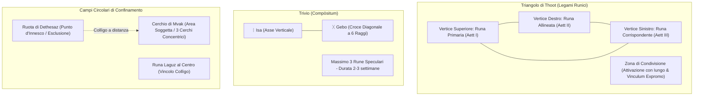

# ᚠ Compendio Accademico delle Antiche Rune & Magia Sigillare
**Dal *Manuale Completo di Studio Magico: Antiche Rune* di Yashiro Isana Mortem**  
*Comitato Incantesimi Sperimentali (C.I.E.) — Alto Consiglio delle Arti Arcane*

---

> [!NOTE]
> Il presente trattato unifica l'analisi filologica, esoterica ed operativa del volume di **Antiche Rune**, correlando le **24 Rune del Futhark Antico** (più la misterica **Runa Bianca**) al corpus degli **Incantesimi**, secondo la doppia matrice di affinità:
> 1. **Affinità per Elemento e Dominio Concettuale** (Fuoco, Acqua, Aria, Terra, Luce, Spirito, Confinamento, Protezione).
> 2. **Risonanza per Valenza Magica Pitagorica (1-9)** e **Controvalenza di Simmetria col 5** (secondo il *Codex Arithmantiae* di Bridget Wenlock e Z. & G. Hawstein).

---

## 1. Il Corpus delle 24 Rune dell'Antico Futhark e la Runa Bianca

L'antico Futhark si articola in **tre Aettir** da otto glifi ciascuno, consacrati alle tre Norne del tempo e del destino (**Urd**, **Verdandi**, **Skuld**). Ciascuna runa è un glifo acrofonico composto esclusivamente da linee rette (prive di orizzontali) che racchiude in sé un **Suono**, un **Nome** e un **Dominio Arcano**.

```
                   ᛟ TESSITURA DEL WYRD ᛟ
     ┌───────────────────────┼───────────────────────┐
  1° Aett (Urd)           2° Aett (Verdandi)      3° Aett (Skuld)
  Origine & Nascita       Divenire & Mutamento    Destino & Compimento
  ᚠ ᚢ ᚦ ᚨ ᚱ ᚲ ᚷ ᚹ        ᚺ ᚾ ᛁ ᛃ ᛇ ᛈ ᛉ ᛋ         ᛏ ᛒ ᛖ ᛗ ᛚ ᛜ ᛟ ᛞ
```

### Tavola Completa delle 24 Rune (+ 1 Speciale)

| # | Glifo | Nome Runa | Aett / Norna | Domini & Significati Chiave | Elemento / Affinità | Somma | Valenza | Opposto (Simm. 5) | Pietra Consacrata |
|---|:---:|---|---|---|---|:---:|:---:|:---:|---|
| **1** | **ᚠ** | **Fehu** | 1° Aett (Urd) | Inizio, creazione, energia spirituale, lavoro, cosmo | Spirito / Generazione | 22 | **4** | **6** | Topazio / Luce |
| **2** | **ᚢ** | **Uruz** | 1° Aett (Urd) | Incremento, forza vitale, potenza primordiale, salute, vigore | Terra / Vigore Primordiale | 23 | **5** | **5** | Ambra / Quarzo |
| **3** | **ᚦ** | **Thurisaz** | 1° Aett (Urd) | Dolore, caos, esplosione, follia, ammaliamento, libertà | Fuoco Caotico / Impatto | 41 | **5** | **5** | Agata / Ossidiana |
| **4** | **ᚨ** | **Ansuz** | 1° Aett (Urd) | Bocca, parola, comunicazione, formula, ordine, legge | Aria / Verbo Sacro | 18 | **9** | **1** | Opale / Aria |
| **5** | **ᚱ** | **Raido** | 1° Aett (Urd) | Ruota (raida), moto perpetuo, viaggio, percorso, messaggio | Cinetica / Spazio | 29 | **2** | **8** | Azzurrite / Etere |
| **6** | **ᚲ** | **Kenaz** | 1° Aett (Urd) | Fiaccola, fiamma di purificazione, guarigione, ristoro | Fuoco Purificatore | 21 | **3** | **7** | Agata / Molibdenite |
| **7** | **ᚷ** | **Gebo** | 1° Aett (Urd) | Dono, unione, incontro, equilibrio, fortuna, scambio | Equilibrio / Simmetria | 20 | **2** | **8** | Ambra / Quarzo |
| **8** | **ᚹ** | **Wunjo** | 1° Aett (Urd) | Gioia, pace, benessere, preghiera, celebrazione, armonia | Luce Emotiva / Etere | 20 | **2** | **8** | Topazio / Opale |
| **9** | **ᚺ** | **Hagalaz** | 2° Aett (Verdandi) | Aria, grandine, tempesta, rottura, forze mutevoli, opposto | Aria / Tempesta (*Hagalantes*) | 29 | **2** | **8** | Opale / Aria |
| **10** | **ᚾ** | **Nauthiz** | 2° Aett (Verdandi) | Necessità, visione, sensibilità, controllo emotivo, vincolo | Spirito / Volontà | 36 | **9** | **1** | Ossidiana / Vincolo |
| **11** | **ᛁ** | **Isa** | 2° Aett (Verdandi) | Ghiaccio, stasi, immobilità, notte, freddo, marea, luna | Acqua Statica / Gelo | 11 | **2** | **8** | Acquamarina / Ghiaccio |
| **12** | **ᛃ** | **Jera** | 2° Aett (Verdandi) | Ciclo, stagioni, raccolto, tempo, giustizia, rispetto | Tempo / Terra Ciclica | 16 | **7** | **3** | Quarzo / Terra |
| **13** | **ᛇ** | **Eihwaz** | 2° Aett (Verdandi) | Albero cosmico, segreti della terra, resurrezione, trionfo | Terra Profonda / Legno | 36 | **9** | **1** | Ambra / Quarzo |
| **14** | **ᛈ** | **Perthr** | 2° Aett (Verdandi) | Fato, destino, segreto, memoria, rivelazione, chiusura | Destino / Occultamento | 40 | **4** | **6** | Labradorite / Onice |
| **15** | **ᛉ** | **Algiz** | 2° Aett (Verdandi) | Protezione, fortezza, inviolabilità, scudo, purezza | Difesa / Scudo Magico | 28 | **1** | **9** | Ossidiana / Protezione |
| **16** | **ᛋ** | **Sowilo** | 2° Aett (Verdandi) | Luce della ragione, sole, vittoria, fulmine, elettricità | Fuoco Celeste / Elettricità | 30 | **3** | **7** | Topazio / Luce |
| **17** | **ᛏ** | **Teiwaz** | 3° Aett (Skuld) | Cielo, maledizione, patto, motivazione, controllo, volontà | Cielo / Giustizia / Maledizione | 30 | **3** | **7** | Onice / Acciaio |
| **18** | **ᛒ** | **Berkana** | 3° Aett (Skuld) | Terra, rigenerazione, nascita, fertilità, raccolto, casa | Terra / Natura (*Maponos*) | 25 | **7** | **3** | Ambra / Smeraldo |
| **19** | **ᛖ** | **Ehwaz** | 3° Aett (Skuld) | Cavallo, animali, avanzamento, svolta, cambiamento repentino | Vita Animale / Cinetica | 27 | **9** | **1** | Quarzo / Ambra |
| **20** | **ᛗ** | **Mannaz** | 3° Aett (Skuld) | Uomo, mente, coscienza umana, intelligenza, scienza, ideali | Mente Umana / Ragione | 24 | **6** | **4** | Topazio / Zaffiro |
| **21** | **ᛚ** | **Laguz** | 3° Aett (Skuld) | Acqua, oceano, trappola, insidia, confinamento, riflesso | Acqua / Abisso (*Arausio*) | 22 | **4** | **6** | Acquamarina / Acqua |
| **22** | **ᛜ** | **Inguz** | 3° Aett (Skuld) | Luce primordiale, anima, portale, varco, ponte, passaggio | Luce / Varchi Spaziali | 32 | **5** | **5** | Topazio / Opale |
| **23** | **ᛟ** | **Othila** | 3° Aett (Skuld) | Unione familiare, legame, guardiano, soglia, radici, eredità | Soglia / Difesa Domestica | 29 | **2** | **8** | Ossidiana / Onice |
| **24** | **ᛞ** | **Dagaz** | 3° Aett (Skuld) | Fuoco, giorno, trasformazione, incendio, cenere, ira | Fuoco Vivente (*Sulis*) | 21 | **3** | **7** | Agata / Molibdenite |
| **✦** | **○** | **Runa Bianca** | Runa Speciale | Assenza trasfigurata in potere, illusione, riprogrammazione | Vuoto Mentale / Illusione | 41 | **5** | **5** | Ciottolo levigato privo di segni |

---

## 2. Il Corpus degli Incantesimi e Rituali Runici (III - VII Anno)

Tutti gli incantesimi codificati nel manuale di Yashiro Isana Mortem si collocano all'interno del percorso didattico di **Antiche Rune** (III-VII Anno):

```mermaid
flowchart TD
    subgraph III_Anno["III Anno: Incisione & Attivazione"]
        Signo["Sìgno (Materia)"]
        Persigno["Persìgno (Etere)"]
        Incipio["Incipìo (Epifania esterna)"]
        Exsequor["Exsèquor (Penetrazione interna)"]
    end
    subgraph IV_Anno["IV Anno: Dissoluzione & Legami"]
        Deleo["[Runa] Dèleo"]
        Exstinguo["[Runa] Exstìnguo"]
        Occulto["Occùlto & Revèlio"]
        Iungo["Iùngo (Triangolo di Thoot)"]
        VinculumExp["Vìnculum Expròmo"]
        VinculumRev["Vìnculum Revèlio"]
        DimotumVinc["Dimòtum Vìnculum"]
    end
    subgraph V_Anno["V Anno: Marchi & Localizzazione"]
        DelineoFuthark["Delìneo Fùthark"]
        StigmaEx["Stìgma Exsèquor"]
        StigmaDet["Stìgma Detecto"]
        Invenio["Invènio (con Hagalaz)"]
    end
    subgraph VI_Anno["VI Anno: Purificazione & Trivio"]
        MaleficumRev["Maleficum Revèlio"]
        RunamTractio["Runam Tractio"]
        ObscurusEpuro["Obscùrus Epuro. Càndor Revèrsio."]
        Compositum["Compòsitum (Trivio con Isa & Gebo)"]
    end
    subgraph VII_Anno["VII Anno: Alta Invocazione & Confinamento"]
        DominiumEv["Dominìum Evòco (Arcanum Invocationis)"]
        RitusElem["Ritus Evocationis Spiritus Elementalis"]
        PerceptioInt["Percèptio Ìntimo (Runa Bianca)"]
        Meteo["Rituale Meteorico (Teiwaz + Sowilo)"]
        Colligo["Collìgo (Catena 2-8 glifi)"]
        SurgeExp["Surge et expandi (Confinamento)"]
        RescindoCap["Rescindo Captio (Dissoluzione)"]
    end

    III_Anno --> IV_Anno --> V_Anno --> VI_Anno --> VII_Anno
```



### Catalogo Dettagliato delle 25 Formule Runiche

#### 📍 Terzo Anno (Incisione e Attivazione)
1. **Sìgno** (`Signo`) — *Valenza 1 (Opposto 9)*
   - **Tipologia**: Tracciamento Runico su Materia.
   - **Effetto**: Incide glifi runici e figure su qualsiasi superficie solida mediante flusso eterico senza contatto fisico.
2. **Persìgno** (`Persigno`) — *Valenza 4 (Opposto 6)*
   - **Tipologia**: Tracciamento Runico nell'Etere.
   - **Effetto**: Sospende nell'aria una runa luminosa diafana e priva di colore, fluttuante nello spazio.
3. **Incipìo** (`Incipio`) — *Valenza 3 (Opposto 7)*
   - **Tipologia**: Attivazione Epifanica Estroflessa.
   - **Effetto**: Fa esplodere il dominio runico verso l'esterno sotto forma di fiammate, getti d'acqua, luce aurorale o coltri d'ombra. Utilizzato nei rituali di evocazione degli spiriti.
4. **Exsèquor** (`Exsequor`) — *Valenza 7 (Opposto 3)*
   - **Tipologia**: Attivazione Penetrante della Sostanza.
   - **Effetto**: Incanala il dominio nelle profondità molecolari della materia (talismani, amuleti, marchi). Agisce solo sulla materia solida, mai sull'etere.

#### 📍 Quarto Anno (Gestione, Dissoluzione e Legami di Thoot)
5. **Dèleo** (`[Nome Runa] Deleo`) — *Valenza 5 (Opposto 5)*
   - **Tipologia**: Cancellazione del Segno.
   - **Effetto**: Dissolve il tracciato di una runa inerte ripercorrendone il disegno originario.
6. **Exstìnguo** (`[Nome Runa] Exstinguo`) — *Valenza 8 (Opposto 2)*
   - **Tipologia**: Disattivazione Energetica.
   - **Effetto**: Estingue il flusso magico di una runa attiva senza cancellarne l'incisione (es. spegne il fuoco di Dagaz).
7. **Occùlto** (`Occulto`) — *Valenza 8 (Opposto 2)*
   - **Tipologia**: Sigillo Celante.
   - **Effetto**: Rende invisibile agli occhi profani una runa attiva, preservandone intatta la carica arcana.
8. **Revèlio** (`Revelio`) — *Valenza 5 (Opposto 5)*
   - **Tipologia**: Rivelazione Visiva.
   - **Effetto**: Rende visibile un'incisione runica occultata.
9. **Iùngo** (`Iungo`) — *Valenza 3 (Opposto 7)*
   - **Tipologia**: Vincolo Triadico di Thoot.
   - **Effetto**: Unisce le tre rune disposte sui vertici del Triangolo di Thoot per creare la Zona di Condivisione.
10. **Vìnculum Expròmo** (`Vinculum Expromo`) — *Valenza 5 (Opposto 5)*
    - **Tipologia**: Attivazione Suprema del Legame Runico.
    - **Effetto**: Puntato al centro della Zona di Condivisione, infonde vita al legame e manifesta l'Archetipo combinato.
11. **Vìnculum Revèlio** (`Vinculum Revelio`) — *Valenza 3 (Opposto 7)*
    - **Tipologia**: Diagnostica di Vincoli Runici.
    - **Effetto**: Genera un filamento luminoso che connette visivamente le rune legate da un vincolo invisibile.
12. **Dimòtum Vìnculum** (`Dimotum Vinculum`) — *Valenza 3 (Opposto 7)*
    - **Tipologia**: Annichilimento di Legame Runico.
    - **Effetto**: Spezza un legame sovrapponendo un secondo triangolo di rune capovolte, provocando un lampo come di specchio infranto.

#### 📍 Quinto Anno (Marchi, Futhark Totale e Localizzazione)
13. **Delìneo Fùthark** (`Delineo Futhark`) — *Valenza 5 (Opposto 5)*
    - **Tipologia**: Evocazione Alfabetica Completa.
    - **Effetto**: Plasma nell'aria o su superfici l'interezza del Futhark in percorsi spiraliformi, curvilinei o geometrici.
14. **Stìgma Exsèquor** (`Stigma Exsequor`) — *Valenza 4 (Opposto 6)*
    - **Tipologia**: Sigillatura di Marchio Semi-Indelebile.
    - **Effetto**: Conclude la marchiatura su carne o materia con una rotazione di 360° in senso orario, fissando il legame tra mago e bersaglio.
15. **Stìgma Detecto** (`Stigma Detecto`) — *Valenza 6 (Opposto 4)*
    - **Tipologia**: Rivelazione di Marchi Occulti.
    - **Effetto**: Traccia un cerchio con tutte le 24 rune attorno al bersaglio; emette tre raggi di luce verso i vertici del triangolo del marchio.
16. **Invènio** (`Invenio [Nome Artefatto]`) — *Valenza 7 (Opposto 3)*
    - **Tipologia**: Localizzazione Telepatica Runicamente Vincolata.
    - **Effetto**: Richiama la memoria di un oggetto su cui è stata preventivamente incisa la runa **Hagalaz** con Exsequor, guidando la mente dell'incantatore entro 1 km.

#### 📍 Sesto Anno (Rivelazione Oscura, Purificazione e Trivio)
17. **Maleficum Revèlio** (`Maleficum Revelio`) — *Valenza 7 (Opposto 3)*
    - **Tipologia**: Divinazione Anti-Maledizione.
    - **Effetto**: Avvolge il bersaglio corrotto da Magia Oscura con fiamme verdastre, impalpabili e gelide.
18. **Runam Tractio** (`Runam Tractio`) — *Valenza 9 (Opposto 1)*
    - **Tipologia**: Convocazione Runiche per Purificazione.
    - **Effetto**: Dispone le rune neutrali nella Ruota di Dethesaz attorno all'oggetto maledetto, generando fulmini tra i glifi attivi.
19. **Obscùrus Epuro. Càndor Revèrsio.** (`Obscurus Epuro. Candor Reversio.`) — *Valenza 4 (Opposto 6)*
    - **Tipologia**: Rito Ordinario di Purificazione.
    - **Effetto**: Dissolve la marea oscura proiettando un fascio di luce bianca purificante sull'artefatto contaminato.
20. **Compòsitum** (`Compositum`) — *Valenza 9 (Opposto 1)*
    - **Tipologia**: Sigillatura del Trivio.
    - **Effetto**: Fonde fino a tre rune all'interno dell'intersezione tra **Isa (ᛁ)** e **Gebo (ᚷ)**, creando un sigillo a sei raggi speculari per due-tre settimane.

#### 📍 Settimo Anno (Alta Invocazione, Spiriti, Illusioni e Confinamento)
21. **Dominìum Evòco** (`Dominium Evoco`) — *Valenza 5 (Opposto 5)*
    - **Tipologia**: Arcanum Invocationis / Massimizzazione del Dominio.
    - **Effetto**: Evocazione tangibile e distruttiva della pienezza archetipica di una runa (potenziatore per incanti tipo *Bombarda Maxima*).
22. **Nul-soleth-konef-Tir-nef-kohal** (*"Noi invochiamo gli Spiriti Naturali"*) — *Valenza 4 (Opposto 6)*
    - **Tipologia**: Invocazione degli Spiriti Elementali Runici.
    - **Effetto**: Convocazione nel Cerchio di Mvak di busti umanoidi di pura energia naturale (*Arausio, Sulis, Maponos, Hagalantes*).
23. **Percèptio Ìntimo** (`Perceptio Intimo`) — *Valenza 7 (Opposto 3)*
    - **Tipologia**: Pratica Illusoria della Runa Bianca.
    - **Effetto**: Sovrascrive la percezione sensoriale, emotiva e mnemonica del bersaglio, proiettando un'illusione totale tangibile per 15-45 minuti.
24. **Ic-oncìplie-jecùndelìcas-gàestas** (*"Io invoco gli spiriti naturali"*) — *Valenza 1 (Opposto 9)*
    - **Tipologia**: Rituale Meteorico.
    - **Effetto**: Modula pioggia, tempesta, sereno o tuono unendo le rune **Teiwaz (ᛏ)** sui palmi con le 4 rune elementali e **Sowilo (ᛋ)** nel Cerchio di Mvak.
25. **Collìgo** (`Colligo`) — *Valenza 1 (Opposto 9)*
    - **Tipologia**: Concatenazione Automatica di Risonanza Sigillare.
    - **Effetto**: Connette in serie da 2 a 8 rune identiche, attivandole in cascata istantanea. Fondamento dei Cerchi di Confinamento (su **Laguz**).
26. **Surge et expandi** (`Surge et expandi`) — *Valenza 6 (Opposto 4)*
    - **Tipologia**: Attivazione del Cerchio di Confinamento (Trappola Runica).
    - **Effetto**: Erige una cupola invisibile e impenetrabile che riflette gli incantesimi e imprigiona l'intruso sigillando terra e aria.
27. **Rescindo Captio** (`Rescindo Captio`) — *Valenza 7 (Opposto 3)*
    - **Tipologia**: Controfirma e Dissoluzione del Confinamento.
    - **Effetto**: Scioglie la gabbia arcana e ripristina l'equilibrio infranto.

---

## 3. Matrice di Corrispondenza: Rune $\longleftrightarrow$ Incantesimi di Hogwarts

L'associazione tra le rune e gli incantesimi del portale si fonda su due chiavi convergenti:
- **Chiave Primaria**: **Affinità per Elemento e Dominio Concettuale**
- **Chiave Secondaria**: **Risonanza per Valenza Magica Pitagorica (1-9)** e **Controvalenza di Simmetria**

```
┌────────────────────────────────────────────────────────────────────────┐
│                      TAVOLA DELLE AFFINITÀ MAGICHE                     │
├─────────────────┬───────────┬───────────────────┬──────────────────────┤
│ Elemento / Sfera│ Runa      │ Valenza Runa      │ Incantesimi Correlati│
├─────────────────┼───────────┼───────────────────┼──────────────────────┤
│ 🌊 Acqua (TLA 1)│ Laguz     │ 4 (Opp. 6)        │ Coerceo (1), Aguamenti│
│                 │ Isa       │ 2 (Opp. 8)        │ Glacius (9), Colligo │
├─────────────────┼───────────┼───────────────────┼──────────────────────┤
│ 🔥 Fuoco (TLA 8)│ Dagaz     │ 3 (Opp. 7)        │ Plasma (8), Incendio │
│                 │ Kenaz     │ 3 (Opp. 7)        │ Confringo (7), Fiend │
├─────────────────┼───────────┼───────────────────┼──────────────────────┤
│ 🌪️ Aria (TLA 5) │ Hagalaz   │ 2 (Opp. 8)        │ Finge (5), Invenio   │
│                 │ Ansuz     │ 9 (Opp. 1)        │ Ventus, Silencio     │
├─────────────────┼───────────┼───────────────────┼──────────────────────┤
│ 🌿 Terra (TLA 6)│ Berkana   │ 7 (Opp. 3)        │ Adultero (6), Herbiv.│
│                 │ Eihwaz    │ 9 (Opp. 1)        │ Duro (1), Orchideus  │
├─────────────────┼───────────┼───────────────────┼──────────────────────┤
│ 🛡️ Protezione   │ Algiz     │ 1 (Opp. 9)        │ Protego (2/8), Total.│
│                 │ Othila    │ 2 (Opp. 8)        │ Cave Inimicum, Fideli│
├─────────────────┼───────────┼───────────────────┼──────────────────────┤
│ ⚡ Folgore/Luce │ Sowilo    │ 3 (Opp. 7)        │ Lumos (4), Stupefic. │
├─────────────────┼───────────┼───────────────────┼──────────────────────┤
│ 🚪 Varchi/Spazio│ Inguz     │ 5 (Opp. 5)        │ Portus, Phi Porta    │
│                 │ Raido     │ 2 (Opp. 8)        │ Transatio, Emineo    │
├─────────────────┼───────────┼───────────────────┼──────────────────────┤
│ ☠️ Maledizione  │ Teiwaz    │ 3 (Opp. 7)        │ Avada Kedavra, Crucio│
│                 │ Thurisaz  │ 5 (Opp. 5)        │ Sectumsempra, Dolohov│
├─────────────────┼───────────┼───────────────────┼──────────────────────┤
│ 👤 Mente/Uomo   │ Mannaz    │ 6 (Opp. 4)        │ Animaleus Nobodyx    │
│                 │ Runa Bianca│ 5 (Opp. 5)       │ Perceptio Intimo, Conf│
└─────────────────┴───────────┴───────────────────┴──────────────────────┘
```

### Dettaglio delle Associazioni Runa-Incantesimo

#### 1. ᚠ FEHU (Spirito, Creazione, Lavoro, Inizio) — Valenza 4
- **Affinità Concettuale**: Creazione ex-nihilo, risveglio vitale, inizio dei cicli.
- **Incantesimi Associati**:
  - *Innerva / Reinnerva* (Valenza 7 / 2): rianimazione della coscienza e del soffio vitale.
  - *Transfiguro* (Valenza 4 — **Risonanza di Valenza esatta**): forma primigenia della trasfigurazione d'aula.
  - *Ritus Evocationis Spiritus Elementalis* (Valenza 4): il manuale impone due rune Fehu come custodi della Manifestazione e dello Spirito nel Cerchio di Mvak.

#### 2. ᚢ URUZ (Forza Primordiale, Toro, Vigore, Accrescimento) — Valenza 5
- **Affinità Concettuale**: Accrescimento di forza e vigore muscolare/strutturale.
- **Incantesimi Associati**:
  - *Engorgio* (Valenza 3): ingrandimento fisico volumetrico.
  - *Flipendo* (Valenza 9, Opposto 1): impatto cinetico puro da toro scatenato.
  - *Triangolo di Thoot*: Uruz è la runa primaria posta al vertice superiore per infondere incremento di forza protettiva.
  - *Marchio Semi-Indelebile*: Uruz al vertice sinistro per infondere incremento della sensibilità.

#### 3. ᚦ THURISAZ (Dolore, Spina, Caos, Esplosione) — Valenza 5
- **Affinità Concettuale**: Ferita acuta, dolore fisico lacerante, distruzione caotica.
- **Incantesimi Associati**:
  - *Crucio* (Valenza 5 — **Risonanza di Valenza esatta**): la maledizione della tortura fisica incarna perfettamente il dominio di Thurisaz.
  - *Diffindo* (Valenza 5 — **Risonanza di Valenza esatta**): taglio netto a spina di rovo.
  - *Bombarda* (Valenza 6): esplosione da breccia.
  - *Marchio del Dolore*: il manuale indica Thurisaz posta al centro della Zona di Condivisione per intensificare la sensibilità al dolore.

#### 4. ᚨ ANSUZ (La Bocca, Il Verbo, La Parola, La Legge) — Valenza 9
- **Affinità Concettuale**: Voce, formula incantatoria, articolazione del linguaggio magico.
- **Incantesimi Associati**:
  - *Silencio* (Valenza 8): controincantesimo che sopprime la voce (controvalenza con la parola).
  - *Balbutio* (Valenza 9 — **Risonanza di Valenza esatta**): maledizione balbuziente che attacca direttamente il dominio di Ansuz.
  - *Densaugeo* (Valenza 2): ostacola la fonazione dei denti.
  - *Sonorus / Quietus*: amplificazione della parola.

#### 5. ᚱ RAIDO (La Ruota, Il Viaggio, Il Moto, Il Messaggio) — Valenza 2
- **Affinità Concettuale**: Spostamento nello spazio, locomozione, ruota e ciclo del cammino.
- **Incantesimi Associati**:
  - *Transatio Objecto* (Valenza 3): triangolo traslatore che muove la materia da un punto all'altro.
  - *Ascendio / Descendo* (Valenza 2 — **Risonanza di Valenza esatta** per Descendo): cinetica ascensionale e discendente.
  - *Locomotor* (Valenza 4): movimento cinetico guidato della materia inerte.
  - *Alarte Ascendare* (Valenza 8 — **Controvalenza di Simmetria** 2+8).

#### 6. ᚲ KENAZ (La Fiaccola, Fiamma Purificatrice, Guarigione) — Valenza 3
- **Affinità Concettuale**: Fuoco nobile, calore benefico, purificazione delle ferite.
- **Incantesimi Associati**:
  - *Episkey* (Valenza 3 — **Risonanza di Valenza esatta**): rimedio curativo rapido per fratture e ferite.
  - *Vulnera Sanentur* (Valenza 3 — **Risonanza di Valenza esatta**): canto curativo che sutura il sangue.
  - *Lacarnum Inflamare* (Valenza 3 — **Risonanza di Valenza esatta**): fiaccola di fuoco azzurrino che scalda senza devastare.

#### 7. ᚷ GEBO (Il Dono, L'Unione, L'Incontro, L'Equilibrio) — Valenza 2
- **Affinità Concettuale**: Simmetria, patto, reciprocità, congiunzione di due anime o due forze.
- **Incantesimi Associati**:
  - *Compòsitum* (Trivio): Gebo intersecata con Isa forma la croce a 6 raggi del Trivio.
  - *Prior Incantatio* (Valenza 5): connessione gemellare armonica tra bacchette sorelle.
  - *Incantesimo Rallegrante* (Valenza 5): dono di euforia e armonia contro la malinconia.

#### 8. ᚹ WUNJO (La Gioia, Il Benessere, La Preghiera) — Valenza 2
- **Affinità Concettuale**: Trionfo della luce interiore, celebrazione spirituale, pace.
- **Incantesimi Associati**:
  - *Expecto Patronum* (Valenza 4 / Opposto 6): emanazione del ricordo più felice per respingere i Dissennatori.
  - *Rictusempra* (Valenza 9): solletico ed euforia cinetica nel duello.
  - *Sortilegio dell'Infelicità Eterna* (Valenza 4 — polarità opposta).

#### 9. ᚺ HAGALAZ (Grandine, Tempesta, Aria, Cambiamento) — Valenza 2
- **Affinità Concettuale**: Spirito *Hagalantes l'Evanescente*, burrasca aerea, forze celesti mutevoli.
- **Incantesimi Associati**:
  - *Invènio* (Valenza 7): il manuale prescrive l'incisione preliminare di Hagalaz per sintonizzare la memoria e rivelare la via perduta.
  - *Finge* (Valenza 5): controllo dell'Aria e delle turbolenze.
  - *Rituale Meteorico* (Valenza 1): Hagalaz è la runa elementale dell'Aria nel Cerchio di Mvak.

#### 10. ᚾ NAUTHIZ (Necessità, Vincolo, Controllo delle Emozioni) — Valenza 9
- **Affinità Concettuale**: Forza del bisogno interiore, costrizione, disciplina stoica.
- **Incantesimi Associati**:
  - *Incarceramus* (Valenza 4): funi che stringono e impongono il vincolo della necessità.
  - *Petrificus Totalus* (Valenza 9 — **Risonanza di Valenza esatta**): paralisi corporale totale che blocca ogni moto.
  - *Triangolo di Thoot*: seconda runa obbligatoria al vertice inferiore destro per legare l'intento.

#### 11. ᛁ ISA (Il Ghiaccio, Stasi, Freddo, Luna, Arresto) — Valenza 2
- **Affinità Concettuale**: Congelamento molecolare, fermata del moto vitale, barriera criogenica.
- **Incantesimi Associati**:
  - *Glacius* (Valenza 9): soffio di ghiaccio che iberna e spegne fiamme.
  - *Immobulus* (Valenza 4): sospensione cinetica che congela il tempo dei bersagli.
  - *Compòsitum*: il segmento verticale centrale di Isa costituisce il pilastro del Trivio runico.

#### 12. ᛃ JERA (Il Raccolto, Le Stagioni, Il Tempo Giusto) — Valenza 7
- **Affinità Concettuale**: Ciclicità temporale, rotazione stagionale, pazienza e compimento.
- **Incantesimi Associati**:
  - *Obstringo Circulum* (Valenza 3 — **Controvalenza di Simmetria** 7+3): trasfigurazione circolare intermittente che ripete i cicli a intervalli fissi.
  - *Reparifarge* (Valenza 5): ritorno al tempo originario del ceppo molecolare.

#### 13. ᛇ EIHWAZ (L'Albero del Mondo, Rinascita, Resurrezione) — Valenza 9
- **Affinità Concettuale**: Asse cosmico Yggdrasil, stabilità millenaria del legno e della terra, trionfo sulle avversità.
- **Incantesimi Associati**:
  - *Duro* (Valenza 1 — **Controvalenza di Simmetria** 9+1): pietrificazione della materia inerte a roccia eterna.
  - *Defodio* (Valenza 4): scavo nelle viscere della terra.

#### 14. ᛈ PERTHR (Il Segreto, Il Fato, Il Ricordo, Il Mistero) — Valenza 4
- **Affinità Concettuale**: Scrigno celato, estrazione del ricordo, mistero del destino.
- **Incantesimi Associati**:
  - *Capio Memoriam* (Valenza 6 — **Controvalenza di Simmetria** 4+6): estrazione del ricordo silente per il Pensatoio.
  - *Fidelius Secretum* (Valenza 4 — **Risonanza di Valenza esatta**): occultamento dell'anima dello spazio nel Custode Segreto.
  - *Obliviate* (Valenza 5): cancellazione della memoria.

#### 15. ᛉ ALGIZ (La Protezione, L'Alce, Il Baluardo, Lo Scudo) — Valenza 1
- **Affinità Concettuale**: Scudo difensivo assoluto, inviolabilità sacra, barriera contro il male.
- **Incantesimi Associati**:
  - *Protego* (Valenza 2 / Opposto 8): scudo fondamentale da duello.
  - *Protego Totalum* (Valenza 9 — **Controvalenza di Simmetria** 1+9): cupola di difesa statica totale.
  - *Cave Inimicum* (Valenza 5): cordone perimetrale d'allarme e sentinella.
  - *Salvio Hexia* (Valenza 2): protezione contro malefici d'area.

#### 16. ᛋ SOWILO (Il Sole, Il Fulmine, La Vittoria della Ragione) — Valenza 3
- **Affinità Concettuale**: Scintilla elettrica primordiale, bagliore solare, folgore.
- **Incantesimi Associati**:
  - *Verdimillious* (Valenza 4): dardo di scintille elettriche verdi che svela e colpisce.
  - *Lumos / Lumos Solem* (Valenza 4 / 3 — **Risonanza di Valenza esatta**): raggio di luce solare pura.
  - *Stupeficium* (Valenza 6): schiantesimo scarlatto che folgora la coscienza.
  - *Rituale Meteorico*: runa cerchiata sul Cerchio di Mvak come simbolo dell'elettricità del tuono.

#### 17. ᛏ TEIWAZ (Il Cielo, La Spada, La Maledizione, Il Patto) — Valenza 3
- **Affinità Concettuale**: Volontà inflessibile, spada della giustizia cosmica o anatema di distruzione.
- **Incantesimi Associati**:
  - *Avada Kedavra* (Valenza 9): l'anatema che uccide è la massima estensione distruttiva della spada di Teiwaz.
  - *Rituale Meteorico*: incisa speculare sui due palmi dell'Evocatore (360° di congiunzione per legare la volta celeste).
  - *Rune Capovolte*: il manuale usa Teiwaz rovesciata come esempio principe per invertire il dominio della difficoltà.

#### 18. ᛒ BERKANA (La Terra Fertile, La Betulla, La Rigenerazione) — Valenza 7
- **Affinità Concettuale**: Spirito *Maponos il Fertile*, linfa botanica, crescita vegetale, vita.
- **Incantesimi Associati**:
  - *Adultero* (Valenza 6): governo e nutrizione della zolla di terra viva.
  - *Herbivicus / Orchideus* (Valenza 4): fioritura istantanea e rinvigorimento di piante.
  - *Ferula* (Valenza 5): steccatura medica con rami vivi.
  - *Triangolo di Thoot*: vertice inferiore sinistro (Terzo Aett) a garanzia di stabilità tellurica.

#### 19. ᛖ EHWAZ (Il Cavallo, La Svolta, La Cinetica Animale) — Valenza 9
- **Affinità Concettuale**: Velocità animale, simbiosi tra cavalcatore e destriero, trasformazione rapida.
- **Incantesimi Associati**:
  - *Feraverto* (Valenza 2): trasfigurazione da animale a calice.
  - *Pullus* (Valenza 2): trasformazione rapida in pollo da duello.
  - *Avifors / Lapifors* (Valenza 5 / 8): metamorfosi bivalente verso creature veloci.

#### 20. ᛗ MANNAZ (L'Uomo, La Coscienza, La Mente Razionale) — Valenza 6
- **Affinità Concettuale**: L'essenza dell'essere umano, l'Io razionale, la mente cosciente.
- **Incantesimi Associati**:
  - *Animaleus Nobodyx* (Valenza 3 — **Controvalenza di Simmetria** 6+4, opposto armonico): ripristino dell'integrità umana dell'animagus.
  - *Homine Reverto* (Valenza 7): regressione completa della licantropia e ritorno alla forma d'uomo.
  - *Confundo* (Valenza 8): attacco diretto alla lucidità di Mannaz.
  - *Legilimanzia / Occlumanzia*: penetrazione e difesa della mente umana.

#### 21. ᛚ LAGUZ (L'Acqua, L'Oceano, La Trappola, Il Confinamento) — Valenza 4
- **Affinità Concettuale**: Spirito *Arausio l'Abissale*, profondità marina, trappola liquida inesorabile.
- **Incantesimi Associati**:
  - *Coerceo* (Valenza 1): formula madre di controllo dei flussi d'acqua.
  - *Cerchi di Confinamento*: Laguz è la **runa primigenia del Confinamento** posta al centro del Cerchio di Mvak e della Ruota di Dethesaz.
  - *Collìgo* (Valenza 1): congiunge le tre Laguz per erigere la cupola impenetrabile.
  - *Aguamenti / Aqua Eructo* (Valenza 6 / 2): zampillo e torrente d'acqua.

#### 22. ᛜ INGUZ (La Luce Primordiale, Il Portale, Il Ponte) — Valenza 5
- **Affinità Concettuale**: Varchi dimensionali, porta tra due spazi, luce originaria.
- **Incantesimi Associati**:
  - *Phi Porta* (Valenza 4): varco proporzionale aureo su pareti solide.
  - *Portus* (Valenza 6 — **Controvalenza di Simmetria** 5+5): creazione di Passaporta per la traslazione istantanea.
  - *Emineo Puteus* (Valenza 6): ponte tra pozzi comunicanti.

#### 23. ᛟ OTHILA (La Soglia, La Casa, Le Radici, Il Guardiano) — Valenza 2
- **Affinità Concettuale**: Confine sacro della dimora, protezione ancestrale della famiglia e del patrimonio.
- **Incantesimi Associati**:
  - *Fidelius Secretum* (Valenza 4): il sigillo sommo di protezione dell'abitazione.
  - *Dominum* (Valenza 8 — **Controvalenza di Simmetria** 2+8): sigillo anti-furto per scrigni e forzieri.
  - *Ruota di Dethesaz*: Othila chiude il perimetro delle 24 rune unendosi a Fehu.

#### 24. ᛞ DAGAZ (Il Fuoco Vivente, Il Giorno, La Trasformazione) — Valenza 3
- **Affinità Concettuale**: Spirito *Sulis l'Ardente*, fiamma radiante, alba trasformatrice, incendio solare.
- **Incantesimi Associati**:
  - *Plasma* (Valenza 8 — **Controvalenza di Simmetria** 3+7, risonanza di fuoco 8): dominio del fuoco magico e naturale.
  - *Incendio* (Valenza 9): getto di fiamme ardenti.
  - *Fiendfyre / Ardemonio* (Valenza 7): fuoco infernale mutaforma.
  - *Incipìo con Dagaz*: il manuale cita esplicitamente Incipìo su Dagaz come esempio di fiamma pura sprigionata nel mondo visibile.

#### ✦ LA RUNA BIANCA (Il Vuoto, L'Assenza, L'Illusione Totale) — Valenza 5
- **Affinità Concettuale**: Lacuna grafica, alterazione percettiva, sovrascrittura di memorie e sensi.
- **Incantesimi Associati**:
  - *Percèptio Ìntimo* (Valenza 7): formula di attivazione della Runa Bianca per allucinazioni sensoriali complete.
  - *Dismundo* (Valenza 6): distorsione claustrofobica della realtà visiva.
  - *Rituale Meteorico*: il ciottolo privo di simboli posto dinanzi al cuore del magus come catalizzatore del vuoto.

---

## 4. Geometrie Sacre e Sistemi Combinatori

Nel manuale accademico vengono codificate quattro architetture operative per la combinazione runica:



1. **Il Triangolo di Thoot**:
   - Supera l'instabilità della coppia binaria imponendo la simmetria trina del triangolo equilatero.
   - Allineamento delle triadi di Thoot $(1:1:1)$ es. **Fehu - Hagalaz - Teiwaz**; oppure $(2:2:2)$ **Uruz - Nauthiz - Berkana**.
   - Formula di chiusura: `Iùngo`.
   - Formula di attivazione suprema: `Vìnculum Expròmo`.
   - Formula diagnostica: `Vìnculum Revèlio`.
   - Formula di annichilimento con rune rovesciate: `Dimòtum Vìnculum`.

2. **Il Trivio (`Compòsitum`)**:
   - Consente di compenetrare fino a tre domini sull'inanimato per 14-21 giorni.
   - Struttura basata sulla fusione tra **Isa (ᛁ)** e **Gebo (ᚷ)** che crea 6 raggi equidistanti su cui incidere tre coppie speculari di rune.
   - Non ammette rune capovolte né incisione su viventi.

3. **I Cerchi di Confinamento (Trappole Runiche)**:
   - Orchestrazione cerimoniale tra **Ruota di Dethesaz** (Punto d'Innesco dove staziona l'Evocatore) e **Cerchio di Mvak** (Perimetro della trappola).
   - Basati sulla runa **Laguz (ᛚ)** incisa al centro e connessa alle rune dei Futhark doppi tramite l'incantesimo **Collìgo**.
   - Attivazione solenne: `Surge et expandi`.
   - Dissoluzione controllata: `Rescindo Captio`.

---

## 5. Sintesi Operativa delle Pietre ed Elementi di Consacrazione

Per forgiare amuleti e talismani duraturi tramite *Exsèquor*, il mago deve armonizzare la runa alla gemma consacrata (Pagina 21):

| Gemma Minerale | Affinità Primaria | Runa Naturale di Elezione | Incantesimo / Dominio |
|---|:---:|:---:|---|
| **Acquamarina** | 🌊 Acqua | **Laguz (ᛚ)** / **Isa (ᛁ)** | *Coerceo*, *Aguamenti*, *Colligo* |
| **Agata** | 🔥 Fuoco | **Dagaz (ᛞ)** / **Kenaz (ᚲ)** | *Plasma*, *Incendio*, *Episkey* |
| **Ambra** | 🌿 Terra | **Berkana (ᛒ)** / **Eihwaz (ᛇ)** | *Adultero*, *Transfiguro*, *Duro* |
| **Azzurrite** | 🌊 Acqua profonda | **Laguz (ᛚ)** / **Raido (ᚱ)** | *Incipio*, *Transatio Objecto* |
| **Molibdenite** | 🔥 Fuoco vivo | **Dagaz (ᛞ)** | *Dominium Evoco*, *Confringo* |
| **Opale** | 🌪️ Aria / Etere | **Hagalaz (ᚺ)** / **Ansuz (ᚨ)** | *Finge*, *Invenio*, *Ventus* |
| **Ossidiana** | 🛡️ Protezione | **Algiz (ᛉ)** / **Othila (ᛟ)** | *Protego*, *Cave Inimicum*, *Dominum* |
| **Quarzo** | 🌿 Terra stabile | **Berkana (ᛒ)** / **Jera (ᛃ)** | *Obstringo Circulum*, *Reparifarge* |
| **Topazio** | ☀️ Luce / Spirito | **Sowilo (ᛋ)** / **Fehu (ᚠ)** / **Inguz (ᛜ)** | *Lumos*, *Phi Porta*, *Ritus Elementalis* |
| **Labradorite** | 🔮 Chiaroveggenza | **Perthr (ᛈ)** | *Capio Memoriam*, *Revelio* |
| **Onice** | ⛓️ Vincolo | **Teiwaz (ᛏ)** / **Nauthiz (ᚾ)** | *Maledictio*, *Incarceramus* |
