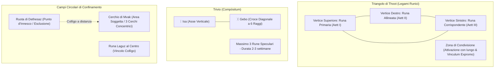

# ᚠ Compendio Accademico delle Antiche Rune & Magia Sigillare
**Dal *Manuale Completo di Studio Magico: Antiche Rune* di Yashiro Isana Mortem**  
*Integrazione con il Codex Arithmantiae di Bridget Wenlock e Z. & G. Hawstein*  
*Comitato Incantesimi Sperimentali (C.I.E.) — Alto Consiglio delle Arti Arcane*

---

> [!IMPORTANT]
> **Canone di Associazione Magica (Valenza & Alfabeto Runico)**:  
> L'associazione tra le rune e gli incantesimi non deriva dalla traslitterazione casuale del nome moderno, bensì dalla rigorosa convergenza tra la **Valenza Magica dell'Incantesimo (1–9)** (calcolata con la Tavola Pitagorica della formula verbale) e la **struttura sacra dell'Alfabeto Runico (Elder Futhark)**:
> 1. **Posizione Ordinale nell'Alfabeto Runico (1–9 = Valenze 1–9)**: la sequenza fissa e immutabile delle prime 9 rune che corrisponde direttamente alle 9 valenze degli incantesimi (Posizione = Valenza).
> 2. **Valore Acrofonico della Lettera Runica**: il suono/fonema primigenio impresso nel glifo ricondotto alla matrice pitagorica.
> 3. **Le Triadi dei Triangoli di Thoot (Posizione 1–8 nei Tre Aettir)**: il vincolo di risonanza simmetrica tra *Urd*, *Verdandi* e *Skuld*.
> 4. **Gli Elementi Fondativi del Codex Arithmantiae**: l'assegnazione rituale canonica dei quattro elementi cardine (*Acqua 1 / Laguz*, *Aria 5 / Hagalaz*, *Terra 6 / Berkana*, *Fuoco 8 / Dagaz*).
> 5. **La Controvalenza di Simmetria col 5**: il principio polare per cui ogni valenza $V$ trova compimento o confinamento nell'opposto $10 - V$ (1 $\leftrightarrow$ 9, 2 $\leftrightarrow$ 8, 3 $\leftrightarrow$ 7, 4 $\leftrightarrow$ 6, 5 $\leftrightarrow$ 5).

---

## 1. Il Corpus delle 24 Rune dell'Antico Futhark e la Runa Bianca

L'antico Futhark si articola in **tre Aettir** da otto glifi ciascuno, consacrati alle tre Norne del tempo e del destino (**Urd**, **Verdandi**, **Skuld**). Ciascuna runa è un glifo acrofonico composto esclusivamente da linee rette (prive di orizzontali) che racchiude in sé un **Simbolo** (il corpo grafico), un **Nome/Suono** (la vibrazione vocale) e un **Dominio Arcano** (l'azione metafisica).

```
                   ᛟ TESSITURA DEL WYRD ᛟ
     ┌───────────────────────┼───────────────────────┐
  1° Aett (Urd)           2° Aett (Verdandi)      3° Aett (Skuld)
  Origine & Nascita       Divenire & Mutamento    Destino & Compimento
  ᚠ ᚢ ᚦ ᚨ ᚱ ᚲ ᚷ ᚹ        ᚺ ᚾ ᛁ ᛃ ᛇ ᛈ ᛉ ᛋ         ᛏ ᛒ ᛖ ᛗ ᛚ ᛜ ᛟ ᛞ
```

### Tavola Completa dell'Alfabeto Runico (Futhark 1–24 + Runa Bianca)

| # | Glifo | Nome Runa | Aett / Norna | Pos. Thoot | Suono (Acrofonia) | Val. Fonetica | Valenza Futhark (1-9) | Opposto (Simm. 5) | Elemento / Dominio Primario | Pietra Consacrata |
|---|:---:|---|---|:---:|:---:|:---:|:---:|:---:|---|---|
| **1** | **ᚠ** | **Fehu** | 1° Aett (Urd) | 1ª | **F** | 6 | **1** (1ª runa) | **9** | Spirito / Creazione / Ricchezza | Topazio / Luce |
| **2** | **ᚢ** | **Uruz** | 1° Aett (Urd) | 2ª | **U** | 3 | **2** (2ª runa) | **8** | Terra / Vigore Primordiale / Toro | Ambra / Quarzo |
| **3** | **ᚦ** | **Thurisaz** | 1° Aett (Urd) | 3ª | **Th / T** | 2 | **3** (3ª runa) | **7** | Fuoco Caotico / Dolore / Spina | Agata / Ossidiana |
| **4** | **ᚨ** | **Ansuz** | 1° Aett (Urd) | 4ª | **A** | 1 | **4** (4ª runa) | **6** | Aria / Verbo Sacro / Bocca | Opale / Aria |
| **5** | **ᚱ** | **Raido** | 1° Aett (Urd) | 5ª | **R** | 9 | **5** (5ª runa) | **5** | Cinetica / Ruota / Viaggio | Azzurrite / Etere |
| **6** | **ᚲ** | **Kenaz** | 1° Aett (Urd) | 6ª | **K / C** | 2 / 3 | **6** (6ª runa) | **4** | Fuoco Purificatore / Fiaccola | Agata / Molibdenite |
| **7** | **ᚷ** | **Gebo** | 1° Aett (Urd) | 7ª | **G** | 7 | **7** (7ª runa) | **3** | Equilibrio / Dono / Unione | Ambra / Quarzo |
| **8** | **ᚹ** | **Wunjo** | 1° Aett (Urd) | 8ª | **W / V** | 5 / 4 | **8** (8ª runa) | **2** | Luce Emotiva / Gioia / Armonia | Topazio / Opale |
| **9** | **ᚺ** | **Hagalaz** | 2° Aett (Verdandi) | 1ª | **H** | 8 | **9** (9ª runa) | **1** | Aria / Tempesta (*Hagalantes*) | Opale / Aria |
| **10** | **ᚾ** | **Nauthiz** | 2° Aett (Verdandi) | 2ª | **N** | 5 | **1** ($10 \rightarrow 1$) | **9** | Spirito / Volontà / Necessità | Ossidiana / Vincolo |
| **11** | **ᛁ** | **Isa** | 2° Aett (Verdandi) | 3ª | **I** | 9 | **2** ($11 \rightarrow 2$) | **8** | Acqua Statica / Gelo / Stasi | Acquamarina / Ghiaccio |
| **12** | **ᛃ** | **Jera** | 2° Aett (Verdandi) | 4ª | **J / Y** | 1 / 7 | **3** ($12 \rightarrow 3$) | **7** | Tempo Ciclico / Raccolto / Giustizia | Quarzo / Terra |
| **13** | **ᛇ** | **Eihwaz** | 2° Aett (Verdandi) | 5ª | **Ei / E** | 5 | **4** ($13 \rightarrow 4$) | **6** | Terra Profonda / Asse Cosmico | Ambra / Quarzo |
| **14** | **ᛈ** | **Perthr** | 2° Aett (Verdandi) | 6ª | **P** | 7 | **5** ($14 \rightarrow 5$) | **5** | Destino / Occultamento / Memoria | Labradorite / Onice |
| **15** | **ᛉ** | **Algiz** | 2° Aett (Verdandi) | 7ª | **Z** | 8 | **6** ($15 \rightarrow 6$) | **4** | Difesa / Scudo / Inviolabilità | Ossidiana / Protezione |
| **16** | **ᛋ** | **Sowilo** | 2° Aett (Verdandi) | 8ª | **S** | 1 | **7** ($16 \rightarrow 7$) | **3** | Fuoco Celeste / Sole / Fulmine | Topazio / Luce |
| **17** | **ᛏ** | **Teiwaz** | 3° Aett (Skuld) | 1ª | **T** | 2 | **8** ($17 \rightarrow 8$) | **2** | Cielo / Volontà / Giustizia / Maledizione | Onice / Acciaio |
| **18** | **ᛒ** | **Berkana** | 3° Aett (Skuld) | 2ª | **B** | 2 | **9** ($18 \rightarrow 9$) | **1** | Terra Viva / Nascita (*Maponos*) | Ambra / Smeraldo |
| **19** | **ᛖ** | **Ehwaz** | 3° Aett (Skuld) | 3ª | **E** | 5 | **1** ($19 \rightarrow 1$) | **9** | Cinetica Animale / Svolta / Cavallo | Quarzo / Ambra |
| **20** | **ᛗ** | **Mannaz** | 3° Aett (Skuld) | 4ª | **M** | 4 | **2** ($20 \rightarrow 2$) | **8** | Mente Umana / Ragione / Uomo | Topazio / Zaffiro |
| **21** | **ᛚ** | **Laguz** | 3° Aett (Skuld) | 5ª | **L** | 3 | **3** ($21 \rightarrow 3$) | **7** | Acqua / Flusso / Confinamento (*Arausio*) | Acquamarina / Acqua |
| **22** | **ᛜ** | **Inguz** | 3° Aett (Skuld) | 6ª | **Ng / I** | 5 / 9 | **4** ($22 \rightarrow 4$) | **6** | Luce Primordiale / Varco / Portale | Topazio / Opale |
| **23** | **ᛟ** | **Othila** | 3° Aett (Skuld) | 7ª | **O** | 6 | **5** ($23 \rightarrow 5$) | **5** | Soglia Sacra / Difesa Domestica | Ossidiana / Onice |
| **24** | **ᛞ** | **Dagaz** | 3° Aett (Skuld) | 8ª | **D** | 4 | **6** ($24 \rightarrow 6$) | **4** | Fuoco Vivente / Giorno (*Sulis*) | Agata / Molibdenite |
| **✦** | **○** | **Runa Bianca** | Fuori Aett | — | **—** | — | **5** (Centro Wyrd) | **5** | Vuoto Mentale / Illusione Assoluta | Ciottolo Levigato |

---

## 2. Il Corpus degli Incantesimi e Rituali Runici (III - VII Anno)

Tutti gli incantesimi codificati nel manuale di Yashiro Isana Mortem si collocano all'interno del percorso didattico di **Antiche Rune** (III-VII Anno):

```mermaid
flowchart TD
    subgraph III_Anno["III Anno: Incisione & Attivazione"]
        Signo["Sìgno (Materia - Val. 1)"]
        Persigno["Persìgno (Etere - Val. 4)"]
        Incipio["Incipìo (Estroflessione - Val. 3)"]
        Exsequor["Exsèquor (Penetrazione - Val. 7)"]
    end
    subgraph IV_Anno["IV Anno: Dissoluzione & Legami"]
        Deleo["[Runa] Dèleo (Cancellazione - Val. 5)"]
        Exstinguo["[Runa] Exstìnguo (Disattivazione - Val. 8)"]
        Occulto["Occùlto & Revèlio (Celamento/Svelamento - Val. 8/5)"]
        Iungo["Iùngo (Triangolo di Thoot - Val. 3)"]
        VinculumExp["Vìnculum Expròmo (Attivazione Legame - Val. 5)"]
        VinculumRev["Vìnculum Revèlio (Diagnostica - Val. 3)"]
        DimotumVinc["Dimòtum Vìnculum (Rottura Legame - Val. 3)"]
    end
    subgraph V_Anno["V Anno: Marchi & Localizzazione"]
        DelineoFuthark["Delìneo Fùthark (Alfabeto Totale - Val. 5)"]
        StigmaEx["Stìgma Exsèquor (Marchiatura - Val. 4)"]
        StigmaDet["Stìgma Detecto (Rilevazione Marchio - Val. 6)"]
        Invenio["Invènio con Hagalaz (Localizzazione - Val. 7)"]
    end
    subgraph VI_Anno["VI Anno: Purificazione & Trivio"]
        MaleficumRev["Maleficum Revèlio (Diagnosi Oscura - Val. 7)"]
        RunamTractio["Runam Tractio (Convocazione - Val. 9)"]
        ObscurusEpuro["Obscùrus Epuro. Càndor Revèrsio. (Purificazione - Val. 4)"]
        Compositum["Compòsitum (Trivio Isa & Gebo - Val. 9)"]
    end
    subgraph VII_Anno["VII Anno: Alta Invocazione & Confinamento"]
        DominiumEv["Dominìum Evòco (Arcanum Invocationis - Val. 5)"]
        RitusElem["Ritus Evocationis Spiritus Elementalis (Val. 4)"]
        PerceptioInt["Percèptio Ìntimo (Runa Bianca - Val. 7)"]
        Meteo["Rituale Meteorico (Teiwaz + Sowilo - Val. 1)"]
        Colligo["Collìgo (Catena 2-8 glifi - Val. 1)"]
        SurgeExp["Surge et expandi (Confinamento - Val. 6)"]
        RescindoCap["Rescindo Captio (Dissoluzione Confinamento - Val. 7)"]
    end

    III_Anno --> IV_Anno --> V_Anno --> VI_Anno --> VII_Anno
```



### Catalogo Dettagliato delle 25 Formule Runiche

#### 📍 Terzo Anno (Incisione e Attivazione)
1. **Sìgno** (`Signo`) — *Valenza 1 (Opposto 9)*  
   - **Tipologia**: Tracciamento Runico su Materia.  
   - **Effetto**: Incide glifi runici e figure su qualsiasi superficie solida mediante flusso eterico senza contatto fisico.
2. **Persìgno** (`Persigno`) — *Valenza 4 (Opposto 6)*  
   - **Tipologia**: Tracciamento Runico nell'Etere.  
   - **Effetto**: Sospende nell'aria una runa luminosa diafana e priva di colore, fluttuante nello spazio.
3. **Incipìo** (`Incipio`) — *Valenza 3 (Opposto 7)*  
   - **Tipologia**: Attivazione Epifanica Estroflessa.  
   - **Effetto**: Fa esplodere il dominio runico verso l'esterno sotto forma di fiammate, getti d'acqua, luce aurorale o coltri d'ombra. Utilizzato nei rituali di evocazione degli spiriti.
4. **Exsèquor** (`Exsequor`) — *Valenza 7 (Opposto 3)*  
   - **Tipologia**: Attivazione Penetrante della Sostanza.  
   - **Effetto**: Incanala il dominio nelle profondità molecolari della materia (talismani, amuleti, marchi). Agisce solo sulla materia solida, mai sull'etere.

#### 📍 Quarto Anno (Gestione, Dissoluzione e Legami di Thoot)
5. **Dèleo** (`[Nome Runa] Deleo`) — *Valenza 5 (Opposto 5)*  
   - **Tipologia**: Cancellazione del Segno.  
   - **Effetto**: Dissolve il tracciato di una runa inerte ripercorrendone il disegno originario.
6. **Exstìnguo** (`[Nome Runa] Exstinguo`) — *Valenza 8 (Opposto 2)*  
   - **Tipologia**: Disattivazione Energetica.  
   - **Effetto**: Estingue il flusso magico di una runa attiva senza cancellarne l'incisione (es. spegne il fuoco di Dagaz).
7. **Occùlto** (`Occulto`) — *Valenza 8 (Opposto 2)*  
   - **Tipologia**: Sigillo Celante.  
   - **Effetto**: Rende invisibile agli occhi profani una runa attiva, preservandone intatta la carica arcana.
8. **Revèlio** (`Revelio`) — *Valenza 5 (Opposto 5)*  
   - **Tipologia**: Rivelazione Visiva.  
   - **Effetto**: Rende visibile un'incisione runica occultata.
9. **Iùngo** (`Iungo`) — *Valenza 3 (Opposto 7)*  
   - **Tipologia**: Vincolo Triadico di Thoot.  
   - **Effetto**: Unisce le tre rune disposte sui vertici del Triangolo di Thoot per creare la Zona di Condivisione.
10. **Vìnculum Expròmo** (`Vinculum Expromo`) — *Valenza 5 (Opposto 5)*  
    - **Tipologia**: Attivazione Suprema del Legame Runico.  
    - **Effetto**: Puntato al centro della Zona di Condivisione, infonde vita al legame e manifesta l'Archetipo combinato.
11. **Vìnculum Revèlio** (`Vinculum Revelio`) — *Valenza 3 (Opposto 7)*  
    - **Tipologia**: Diagnostica di Vincoli Runici.  
    - **Effetto**: Genera un filamento luminoso che connette visivamente le rune legate da un vincolo invisibile.
12. **Dimòtum Vìnculum** (`Dimotum Vinculum`) — *Valenza 3 (Opposto 7)*  
    - **Tipologia**: Annichilimento di Legame Runico.  
    - **Effetto**: Spezza un legame sovrapponendo un secondo triangolo di rune capovolte, provocando un lampo come di specchio infranto.

#### 📍 Quinto Anno (Marchi, Futhark Totale e Localizzazione)
13. **Delìneo Fùthark** (`Delineo Futhark`) — *Valenza 5 (Opposto 5)*  
    - **Tipologia**: Evocazione Alfabetica Completa.  
    - **Effetto**: Plasma nell'aria o su superfici l'interezza del Futhark in percorsi spiraliformi, curvilinei o geometrici.
14. **Stìgma Exsèquor** (`Stigma Exsequor`) — *Valenza 4 (Opposto 6)*  
    - **Tipologia**: Sigillatura di Marchio Semi-Indelebile.  
    - **Effetto**: Conclude la marchiatura su carne o materia con una rotazione di 360° in senso orario, fissando il legame tra mago e bersaglio.
15. **Stìgma Detecto** (`Stigma Detecto`) — *Valenza 6 (Opposto 4)*  
    - **Tipologia**: Rivelazione di Marchi Occulti.  
    - **Effetto**: Traccia un cerchio con tutte le 24 rune attorno al bersaglio; emette tre raggi di luce verso i vertici del triangolo del marchio.
16. **Invènio** (`Invenio [Nome Artefatto]`) — *Valenza 7 (Opposto 3)*  
    - **Tipologia**: Localizzazione Telepatica Runicamente Vincolata.  
    - **Effetto**: Richiama la memoria di un oggetto su cui è stata preventivamente incisa la runa **Hagalaz** con Exsequor, guidando la mente dell'incantatore entro 1 km.

#### 📍 Sesto Anno (Rivelazione Oscura, Purificazione e Trivio)
17. **Maleficum Revèlio** (`Maleficum Revelio`) — *Valenza 7 (Opposto 3)*  
    - **Tipologia**: Divinazione Anti-Maledizione.  
    - **Effetto**: Avvolge il bersaglio corrotto da Magia Oscura con fiamme verdastre, impalpabili e gelide.
18. **Runam Tractio** (`Runam Tractio`) — *Valenza 9 (Opposto 1)*  
    - **Tipologia**: Convocazione Runiche per Purificazione.  
    - **Effetto**: Dispone le rune neutrali nella Ruota di Dethesaz attorno all'oggetto maledetto, generando fulmini tra i glifi attivi.
19. **Obscùrus Epuro. Càndor Revèrsio.** (`Obscurus Epuro. Candor Reversio.`) — *Valenza 4 (Opposto 6)*  
    - **Tipologia**: Rito Ordinario di Purificazione.  
    - **Effetto**: Dissolve la marea oscura proiettando un fascio di luce bianca purificante sull'artefatto contaminato.
20. **Compòsitum** (`Compositum`) — *Valenza 9 (Opposto 1)*  
    - **Tipologia**: Sigillatura del Trivio.  
    - **Effetto**: Fonde fino a tre rune all'interno dell'intersezione tra **Isa (ᛁ)** e **Gebo (ᚷ)**, creando un sigillo a sei raggi speculari per due-tre settimane.

#### 📍 Settimo Anno (Alta Invocazione, Spiriti, Illusioni e Confinamento)
21. **Dominìum Evòco** (`Dominium Evoco`) — *Valenza 5 (Opposto 5)*  
    - **Tipologia**: Arcanum Invocationis / Massimizzazione del Dominio.  
    - **Effetto**: Evocazione tangibile e distruttiva della pienezza archetipica di una runa (potenziatore per incanti tipo *Bombarda Maxima*).
22. **Nul-soleth-konef-Tir-nef-kohal** (*"Noi invochiamo gli Spiriti Naturali"*) — *Valenza 4 (Opposto 6)*  
    - **Tipologia**: Invocazione degli Spiriti Elementali Runici.  
    - **Effetto**: Convocazione nel Cerchio di Mvak di busti umanoidi di pura energia naturale (*Arausio, Sulis, Maponos, Hagalantes*).
23. **Percèptio Ìntimo** (`Perceptio Intimo`) — *Valenza 7 (Opposto 3)*  
    - **Tipologia**: Pratica Illusoria della Runa Bianca.  
    - **Effetto**: Sovrascrive la percezione sensoriale, emotiva e mnemonica del bersaglio, proiettando un'illusione totale tangibile per 15-45 minuti.
24. **Ic-oncìplie-jecùndelìcas-gàestas** (*"Io invoco gli spiriti naturali"*) — *Valenza 1 (Opposto 9)*  
    - **Tipologia**: Rituale Meteorico.  
    - **Effetto**: Modula pioggia, tempesta, sereno o tuono unendo le rune **Teiwaz (ᛏ)** sui palmi con le 4 rune elementali e **Sowilo (ᛋ)** nel Cerchio di Mvak.
25. **Collìgo** (`Colligo`) — *Valenza 1 (Opposto 9)*  
    - **Tipologia**: Concatenazione Automatica di Risonanza Sigillare.  
    - **Effetto**: Connette in serie da 2 a 8 rune identiche, attivandole in cascata istantanea. Fondamento dei Cerchi di Confinamento (su **Laguz**).
26. **Surge et expandi** (`Surge et expandi`) — *Valenza 6 (Opposto 4)*  
    - **Tipologia**: Attivazione del Cerchio di Confinamento (Trappola Runica).  
    - **Effetto**: Erige una cupola invisibile e impenetrabile che riflette gli incantesimi e imprigiona l'intruso sigillando terra e aria.
27. **Rescindo Captio** (`Rescindo Captio`) — *Valenza 7 (Opposto 3)*  
    - **Tipologia**: Controfirma e Dissoluzione del Confinamento.  
    - **Effetto**: Scioglie la gabbia arcana e ripristina l'equilibrio infranto.

---

## 3. Matrice di Corrispondenza: Valenza dell'Incantesimo $\longleftrightarrow$ Alfabeto Runico

L'associazione tra gli incantesimi e le rune risponde al principio cardine dell'Arimanzia Operativa:
$$\text{Incantesimo} \xrightarrow{\text{Formula verbale}} \text{Valenza Magica } (1-9) \longleftrightarrow \text{Alfabeto Runico } (\text{Futhark 1–24 / Acrofonia / Triadi})$$

```
┌──────────────────────────────────────────────────────────────────────────────────────────────────┐
│              MATRICE SINOTTICA: VALENZA DELL'INCANTESIMO ⟷ ALFABETO RUNICO                       │
├─────────┬──────────────────────┬──────────────────────┬─────────────┬──────────┬─────────────────┤
│ Valenza │ Runa Futhark Ordinale│ Rune Acrofoniche     │ Elemento    │ Opposto  │ Esempi Incanti  │
│ Magica  │ (Posizione 1–9)      │ (Fonema Pitagorico)  │ Rituale     │ (Simm. 5)│ Associati       │
├─────────┼──────────────────────┼──────────────────────┼─────────────┼──────────┼─────────────────┤
│ **1**   │ ᚠ Fehu (Pos. 1ª)     │ ᚨ Ansuz (A = 1)      │ 🌊 Acqua    │ **9**    │ Aguamenti (1),   │
│         │                      │ ᛃ Jera (J = 1)       │ (*Coerceo / │          │ Reparo (1),     │
│         │                      │ ᛋ Sowilo (S = 1)     │  Laguz*)    │          │ Signo, Colligo  │
├─────────┼──────────────────────┼──────────────────────┼─────────────┼──────────┼─────────────────┤
│ **2**   │ ᚢ Uruz (Pos. 2ª)     │ ᛒ Berkana (B = 2)    │ —           │ **8**    │ Expelliarmus (2)│
│         │                      │ ᚲ Kenaz (K = 2)      │             │          │ Innerva (2),    │
│         │                      │ ᛏ Teiwaz (T = 2)     │             │          │ Fumos, Riddikul.│
├─────────┼──────────────────────┼──────────────────────┼─────────────┼──────────┼─────────────────┤
│ **3**   │ ᚦ Thurisaz (Pos. 3ª) │ ᚲ Kenaz (C = 3)      │ —           │ **7**    │ Arresto Moment. │
│         │                      │ ᛚ Laguz (L = 3)      │             │          │ Orchideus (3),  │
│         │                      │ ᚢ Uruz (U = 3)       │             │          │ Incipio, Iungo  │
├─────────┼──────────────────────┼──────────────────────┼─────────────┼──────────┼─────────────────┤
│ **4**   │ ᚨ Ansuz (Pos. 4ª)    │ ᛞ Dagaz (D = 4)      │ —           │ **6**    │ Liberacorpus (4)│
│         │                      │ ᛗ Mannaz (M = 4)     │             │          │ Diffindo (4),   │
│         │                      │ ᚹ Wunjo (V = 4)      │             │          │ Persigno, Stigma│
├─────────┼──────────────────────┼──────────────────────┼─────────────┼──────────┼─────────────────┤
│ **5**   │ ᚱ Raido (Pos. 5ª)    │ ᛖ Ehwaz (E = 5)      │ 🌪️ Aria     │ **5**    │ Levicorpus (5), │
│         │                      │ ᚾ Nauthiz (N = 5)    │ (*Finge /   │          │ Immobilus (5),  │
│         │                      │ ᚹ Wunjo (W = 5)      │  Hagalaz*)  │          │ Deleo, Dominium │
├─────────┼──────────────────────┼──────────────────────┼─────────────┼──────────┼─────────────────┤
│ **6**   │ ᚲ Kenaz (Pos. 6ª)    │ ᚠ Fehu (F = 6)       │ 🌿 Terra    │ **4**    │ Protego (6),    │
│         │                      │ ᛟ Othila (O = 6)     │ (*Adultero /│          │ Verdimillious (6│
│         │                      │                      │  Berkana*)  │          │ Surge et expandi│
├─────────┼──────────────────────┼──────────────────────┼─────────────┼──────────┼─────────────────┤
│ **7**   │ ᚷ Gebo (Pos. 7ª)     │ ᚷ Gebo (G = 7)       │ —           │ **3**    │ Stupeficium (7),│
│         │                      │ ᛈ Perthr (P = 7)     │             │          │ Vulnera Sanentur│
│         │                      │ ᛃ Jera (Y = 7)       │             │          │ Exsequor, Inveni│
├─────────┼──────────────────────┼──────────────────────┼─────────────┼──────────┼─────────────────┤
│ **8**   │ ᚹ Wunjo (Pos. 8ª)    │ ᚺ Hagalaz (H = 8)    │ 🔥 Fuoco    │ **2**    │ Incendio (8),   │
│         │                      │ ᛉ Algiz (Z = 8)      │ (*Plasma /  │          │ Lumos (8),      │
│         │                      │                      │  Dagaz*)    │          │ Alohomora (8)   │
├─────────┼──────────────────────┼──────────────────────┼─────────────┼──────────┼─────────────────┤
│ **9**   │ ᚺ Hagalaz (Pos. 9ª)  │ ᛁ Isa (I = 9)        │ —           │ **1**    │ Flipendo (9),   │
│         │                      │ ᚱ Raido (R = 9)      │             │          │ Petrificus (9), │
│         │                      │ ᛜ Inguz (Ing = 9)    │             │          │ Glacius, Compos.│
└─────────┴──────────────────────┴──────────────────────┴─────────────┴──────────┴─────────────────┘
```

---

### Dettaglio Monografico delle 24 Rune (+ Runa Bianca)

#### 1. ᚠ FEHU — 1ª Runa dell'Alfabeto Runico
- **Collocazione Futhark**: 1° Aett (Urd) — Posizione 1 (Vertice del Triangolo di Thoot con Hagalaz e Teiwaz).
- **Valenza Ordinale Futhark**: **1** (1ª runa dell'alfabeto).
- **Suono & Valenza Fonetica**: **F** (Valore Pitagorico **6**).
- **Opposto di Simmetria col 5**: **9** (Opposto di Fehu ordinale: 10 - 1 = 9).
- **Domini & Archetipi**: Spirito, creazione primigenia, lavoro, ricchezza, energia vitale cosmica.
- **Risonanza con Incantesimi**:
  - *Incantesimi di Valenza 1 (Risonanza Ordinale)*: *Incendio* (1), *Reparo* (1), *Signo* (1), *Colligo* (1).
  - *Incantesimi di Valenza 6 (Risonanza Fonetica F=6)*: *Protego* (6), *Surge et expandi* (6).
  - *Incantesimi di Valenza 9 (Controvalenza di Simmetria)*: *Flipendo* (9), *Compositum* (9).
  - *Rito Canonico*: Due Fehu vigilano la Manifestazione dello Spirito nel Cerchio di Mvak.

#### 2. ᚢ URUZ — 2ª Runa dell'Alfabeto Runico
- **Collocazione Futhark**: 1° Aett (Urd) — Posizione 2 (Triade con Nauthiz e Berkana).
- **Valenza Ordinale Futhark**: **2** (2ª runa dell'alfabeto).
- **Suono & Valenza Fonetica**: **U** (Valore Pitagorico **3**).
- **Opposto di Simmetria col 5**: **8** (Opposto di 2: 10 - 2 = 8).
- **Domini & Archetipi**: Terra, forza primordiale, toro scatenato, vigore, salute, accrescimento strutturale.
- **Risonanza con Incantesimi**:
  - *Incantesimi di Valenza 2 (Risonanza Ordinale)*: *Expelliarmus* (2), *Innerva* (2), *Fumos* (2).
  - *Incantesimi di Valenza 3 (Risonanza Fonetica U=3)*: *Engorgio* (3), *Orchideus* (3).
  - *Incantesimi di Valenza 8 (Controvalenza di Simmetria)*: *Lumos* (8), *Exstinguo* (8).
  - *Triangolo di Thoot*: Uruz è la runa primaria al vertice superiore per infondere incremento di forza protettiva.

#### 3. ᚦ THURISAZ — 3ª Runa dell'Alfabeto Runico
- **Collocazione Futhark**: 1° Aett (Urd) — Posizione 3 (Triade con Isa ed Ehwaz).
- **Valenza Ordinale Futhark**: **3** (3ª runa dell'alfabeto).
- **Suono & Valenza Fonetica**: **Th / T** (Valore Pitagorico **2**).
- **Opposto di Simmetria col 5**: **7** (Opposto di 3: 10 - 3 = 7).
- **Domini & Archetipi**: Fuoco caotico, spina lacerante, dolore, abbattimento di ostacoli, follia, libertà.
- **Risonanza con Incantesimi**:
  - *Incantesimi di Valenza 3 (Risonanza Ordinale)*: *Arresto Momentum* (3), *Incipio* (3), *Iungo* (3).
  - *Incantesimi di Valenza 7 (Controvalenza di Simmetria)*: *Stupeficium* (7), *Vulnera Sanentur* (7), *Exsequor* (7).
  - *Marchio del Dolore*: Thurisaz posta al centro della Zona di Condivisione per esacerbare la vulnerabilità fisica.

#### 4. ᚨ ANSUZ — 4ª Runa dell'Alfabeto Runico
- **Collocazione Futhark**: 1° Aett (Urd) — Posizione 4 (Triade con Jera e Mannaz).
- **Valenza Ordinale Futhark**: **4** (4ª runa dell'alfabeto).
- **Suono & Valenza Fonetica**: **A** (Valore Pitagorico **1**).
- **Opposto di Simmetria col 5**: **6** (Opposto di 4: 10 - 4 = 6).
- **Domini & Archetipi**: Aria, verbo sacro, bocca, formula magica, comunicazione, ordine divino, legge.
- **Risonanza con Incantesimi**:
  - *Incantesimi di Valenza 4 (Risonanza Ordinale)*: *Liberacorpus* (4), *Diffindo* (4), *Persigno* (4), *Stigma Exsequor* (4).
  - *Incantesimi di Valenza 1 (Risonanza Fonetica A=1)*: *Signo* (1), *Rituale Meteorico* (1).
  - *Incantesimi di Valenza 6 (Controvalenza di Simmetria)*: *Silencio* (controincantesimo fonetico), *Stigma Detecto* (6).

#### 5. ᚱ RAIDO — 5ª Runa dell'Alfabeto Runico
- **Collocazione Futhark**: 1° Aett (Urd) — Posizione 5 (Triade con Eihwaz e Laguz).
- **Valenza Ordinale Futhark**: **5** (5ª runa dell'alfabeto).
- **Suono & Valenza Fonetica**: **R** (Valore Pitagorico **9**).
- **Opposto di Simmetria col 5**: **5** (Runa Speculare Autonoma: 10 - 5 = 5).
- **Domini & Archetipi**: Cinetica, ruota del destino, viaggio, sentiero, messaggero, ciclo del moto continuo.
- **Risonanza con Incantesimi**:
  - *Incantesimi di Valenza 5 (Risonanza Ordinale & Simmetria)*: *Levicorpus* (5), *Deleo* (5), *Revelio* (5), *Vinculum Expromo* (5).
  - *Incantesimi di Valenza 9 (Risonanza Fonetica R=9)*: *Locomotor* (9), *Glacius* (9).
  - *Rituali di Movimento*: Citata nel *Codex Arithmantiae* (p. 94) assieme al numero 37 per rituali di traslazione.

#### 6. ᚲ KENAZ — 6ª Runa dell'Alfabeto Runico
- **Collocazione Futhark**: 1° Aett (Urd) — Posizione 6 (Triade con Perthr e Inguz).
- **Valenza Ordinale Futhark**: **6** (6ª runa dell'alfabeto).
- **Suono & Valenza Fonetica**: **K / C** (Valore Pitagorico **2** / **3**).
- **Opposto di Simmetria col 5**: **4** (Opposto di 6: 10 - 6 = 4).
- **Domini & Archetipi**: Fuoco controllato, fiaccola, calore benefico, purificazione delle ferite, rigenerazione.
- **Risonanza con Incantesimi**:
  - *Incantesimi di Valenza 6 (Risonanza Ordinale)*: *Protego* (6), *Surge et expandi* (6).
  - *Incantesimi di Valenza 3 (Risonanza Fonetica C=3)*: *Episkey* (3), *Incipio* (3).
  - *Incantesimi di Valenza 4 (Controvalenza di Simmetria)*: *Obscurus Epuro* (4), *Persigno* (4).

#### 7. ᚷ GEBO — 7ª Runa dell'Alfabeto Runico
- **Collocazione Futhark**: 1° Aett (Urd) — Posizione 7 (Triade con Algiz e Othila).
- **Valenza Ordinale Futhark**: **7** (7ª runa dell'alfabeto).
- **Suono & Valenza Fonetica**: **G** (Valore Pitagorico **7** — *Doppia Risonanza Settenaria!*).
- **Opposto di Simmetria col 5**: **3** (Opposto di 7: 10 - 7 = 3).
- **Domini & Archetipi**: Dono, unione, patto, reciprocità, congiunzione armonica di due forze, simmetria.
- **Risonanza con Incantesimi**:
  - *Incantesimi di Valenza 7 (Risonanza Ordinale & Fonetica)*: *Stupeficium* (7), *Vulnera Sanentur* (7), *Exsequor* (7), *Invenio* (7).
  - *Incantesimi di Valenza 3 (Controvalenza di Simmetria)*: *Iungo* (3), *Dimotum Vinculum* (3).
  - *Trivio Runico*: Gebo intersecata a Isa forma la struttura a 6 raggi di *Compositum*.

#### 8. ᚹ WUNJO — 8ª Runa dell'Alfabeto Runico
- **Collocazione Futhark**: 1° Aett (Urd) — Posizione 8 (Triade con Sowilo e Dagaz).
- **Valenza Ordinale Futhark**: **8** (8ª runa dell'alfabeto).
- **Suono & Valenza Fonetica**: **W / V** (Valore Pitagorico **5** / **4**).
- **Opposto di Simmetria col 5**: **2** (Opposto di 8: 10 - 8 = 2).
- **Domini & Archetipi**: Gioia pura, benessere, armonia spirituale, preghiera, luce emotiva, celebrazione.
- **Risonanza con Incantesimi**:
  - *Incantesimi di Valenza 8 (Risonanza Ordinale)*: *Lumos* (8), *Alohomora* (8), *Exstinguo* (8), *Occulto* (8).
  - *Incantesimi di Valenza 2 (Controvalenza di Simmetria)*: *Innerva* (2), *Expelliarmus* (2).
  - *Incantesimi di Valenza 5 (Risonanza Fonetica W=5)*: *Expecto Patronum* (sortilegio di gioia suprema).

#### 9. ᚺ HAGALAZ — 9ª Runa dell'Alfabeto Runico
- **Collocazione Futhark**: 2° Aett (Verdandi) — Posizione 1 (Triade con Fehu e Teiwaz).
- **Valenza Ordinale Futhark**: **9** (9ª runa dell'alfabeto).
- **Suono & Valenza Fonetica**: **H** (Valore Pitagorico **8**).
- **Opposto di Simmetria col 5**: **1** (Opposto di 9: 10 - 9 = 1).
- **Domini & Archetipi**: Spirito *Hagalantes l'Evanescente*, elemento Aria nel Codex (Numero 5 rituale), grandine, tempesta, mutamento.
- **Risonanza con Incantesimi**:
  - *Incantesimi di Valenza 9 (Risonanza Ordinale)*: *Flipendo* (9), *Compositum* (9), *Runam Tractio* (9).
  - *Incantesimi di Valenza 1 (Controvalenza di Simmetria)*: *Signo* (1), *Rituale Meteorico* (1).
  - *Incantesimi di Valenza 5 (Elemento Aria nel Codex)*: *Finge* (5).
  - *Invenio*: Hagalaz incisa preventivamente sull'artefatto permette la sintonizzazione telepatica.

#### 10. ᚾ NAUTHIZ — 10ª Runa dell'Alfabeto Runico
- **Collocazione Futhark**: 2° Aett (Verdandi) — Posizione 2 (Triade con Uruz e Berkana).
- **Valenza Ordinale Futhark**: **1** ($10 \rightarrow 1+0 = 1$).
- **Suono & Valenza Fonetica**: **N** (Valore Pitagorico **5**).
- **Opposto di Simmetria col 5**: **9** (Opposto di 1: 10 - 1 = 9).
- **Domini & Archetipi**: Spirito, necessità ineluttabile, vincolo interiore, stoicismo, controllo delle emozioni, carattere.
- **Risonanza con Incantesimi**:
  - *Incantesimi di Valenza 1 (Risonanza Ordinale ridotta)*: *Incendio* (1), *Reparo* (1), *Signo* (1).
  - *Incantesimi di Valenza 5 (Risonanza Fonetica N=5)*: *Incarceramus* (vincolo delle corde), *Vinculum Expromo* (5).
  - *Incantesimi di Valenza 9 (Controvalenza di Simmetria)*: *Petrificus Totalus* (9), *Glacius* (9).
  - *Rituali del Codex*: Impiegata nei rituali della vista (p. 93) e nel sigillo protettivo caldeo su ottagono (p. 105).

#### 11. ᛁ ISA — 11ª Runa dell'Alfabeto Runico
- **Collocazione Futhark**: 2° Aett (Verdandi) — Posizione 3 (Triade con Thurisaz ed Ehwaz).
- **Valenza Ordinale Futhark**: **2** ($11 \rightarrow 1+1 = 2$).
- **Suono & Valenza Fonetica**: **I** (Valore Pitagorico **9**).
- **Opposto di Simmetria col 5**: **8** (Opposto di 2: 10 - 2 = 8).
- **Domini & Archetipi**: Acqua congelata, ghiaccio primigenio, stasi molecolare, notte, arresto del moto, luna.
- **Risonanza con Incantesimi**:
  - *Incantesimi di Valenza 2 (Risonanza Ordinale ridotta)*: *Expelliarmus* (2), *Fumos* (2).
  - *Incantesimi di Valenza 9 (Risonanza Fonetica I=9)*: *Glacius* (9), *Petrificus Totalus* (9).
  - *Incantesimi di Valenza 8 (Controvalenza di Simmetria)*: *Lumos* (8), *Exstinguo* (8).
  - *Asse del Trivio*: Il pilastro verticale centrale di Isa sostiene l'intera architettura di *Compositum*.

#### 12. ᛃ JERA — 12ª Runa dell'Alfabeto Runico
- **Collocazione Futhark**: 2° Aett (Verdandi) — Posizione 4 (Triade con Ansuz e Mannaz).
- **Valenza Ordinale Futhark**: **3** ($12 \rightarrow 1+2 = 3$).
- **Suono & Valenza Fonetica**: **J / Y** (Valore Pitagorico **1** / **7**).
- **Opposto di Simmetria col 5**: **7** (Opposto di 3: 10 - 3 = 7).
- **Domini & Archetipi**: Tempo circolare, successione delle stagioni, raccolto, giustizia terrena, maturazione feconda.
- **Risonanza con Incantesimi**:
  - *Incantesimi di Valenza 3 (Risonanza Ordinale ridotta)*: *Arresto Momentum* (3), *Incipio* (3), *Iungo* (3).
  - *Incantesimi di Valenza 7 (Controvalenza di Simmetria)*: *Stupeficium* (7), *Exsequor* (7).
  - *Magia Trasfiguratoria*: Risonanza con *Obstringo Circulum* (ciclo trasfiguratorio continuo).

#### 13. ᛇ EIHWAZ — 13ª Runa dell'Alfabeto Runico
- **Collocazione Futhark**: 2° Aett (Verdandi) — Posizione 5 (Triade con Raido e Laguz).
- **Valenza Ordinale Futhark**: **4** ($13 \rightarrow 1+3 = 4$).
- **Suono & Valenza Fonetica**: **Ei / E** (Valore Pitagorico **5**).
- **Opposto di Simmetria col 5**: **6** (Opposto di 4: 10 - 4 = 6).
- **Domini & Archetipi**: Asse Cosmico (Yggdrasil), albero del mondo, rinascita dalle ceneri, trionfo sulle avversità.
- **Risonanza con Incantesimi**:
  - *Incantesimi di Valenza 4 (Risonanza Ordinale ridotta)*: *Liberacorpus* (4), *Diffindo* (4), *Persigno* (4).
  - *Incantesimi di Valenza 6 (Controvalenza di Simmetria)*: *Protego* (6), *Surge et expandi* (6).
  - *Terra profonda*: Sinergia con *Duro* (pietrificazione) e *Defodio* (scavo).

#### 14. ᛈ PERTHR — 14ª Runa dell'Alfabeto Runico
- **Collocazione Futhark**: 2° Aett (Verdandi) — Posizione 6 (Triade con Kenaz e Inguz).
- **Valenza Ordinale Futhark**: **5** ($14 \rightarrow 1+4 = 5$).
- **Suono & Valenza Fonetica**: **P** (Valore Pitagorico **7**).
- **Opposto di Simmetria col 5**: **5** (Runa Speculare Autonoma: 10 - 5 = 5).
- **Domini & Archetipi**: Fato imperscrutabile, scrigno dei segreti, estrazione del ricordo, mistero oracolare.
- **Risonanza con Incantesimi**:
  - *Incantesimi di Valenza 5 (Risonanza Ordinale ridotta & Simmetria)*: *Levicorpus* (5), *Deleo* (5), *Revelio* (5).
  - *Incantesimi di Valenza 7 (Risonanza Fonetica P=7)*: *Exsequor* (7), *Maleficum Revelio* (7).
  - *Codex Arithmantiae*: Usata nei rituali dei ricordi celati (p. 97-98) per fissare memorie indelebili.

#### 15. ᛉ ALGIZ — 15ª Runa dell'Alfabeto Runico
- **Collocazione Futhark**: 2° Aett (Verdandi) — Posizione 7 (Triade con Gebo e Othila).
- **Valenza Ordinale Futhark**: **6** ($15 \rightarrow 1+5 = 6$).
- **Suono & Valenza Fonetica**: **Z** (Valore Pitagorico **8**).
- **Opposto di Simmetria col 5**: **4** (Opposto di 6: 10 - 6 = 4).
- **Domini & Archetipi**: Baluardo difensivo, corna dell'alce, inviolabilità dello spazio, scudo contro il male, purezza.
- **Risonanza con Incantesimi**:
  - *Incantesimi di Valenza 6 (Risonanza Ordinale ridotta)*: *Protego* (6 — **Risonanza Assoluta di Scudo!**), *Surge et expandi* (6).
  - *Incantesimi di Valenza 8 (Risonanza Fonetica Z=8)*: *Salvio Hexia* (8), *Lumos* (8).
  - *Incantesimi di Valenza 4 (Controvalenza di Simmetria)*: *Liberacorpus* (4), *Stigma Exsequor* (4).
  - *Legami di Thoot*: Algiz al vertice superiore del secondo triangolo unita a Uruz per blindare gabbie e barriere.

#### 16. ᛋ SOWILO — 16ª Runa dell'Alfabeto Runico
- **Collocazione Futhark**: 2° Aett (Verdandi) — Posizione 8 (Triade con Wunjo e Dagaz).
- **Valenza Ordinale Futhark**: **7** ($16 \rightarrow 1+6 = 7$).
- **Suono & Valenza Fonetica**: **S** (Valore Pitagorico **1**).
- **Opposto di Simmetria col 5**: **3** (Opposto di 7: 10 - 7 = 3).
- **Domini & Archetipi**: Sole trionfante, scintilla elettrica, folgore, fulmine, lucidità mentale, vittoria.
- **Risonanza con Incantesimi**:
  - *Incantesimi di Valenza 7 (Risonanza Ordinale ridotta)*: *Stupeficium* (7 — scarica folgorante), *Vulnera Sanentur* (7), *Exsequor* (7).
  - *Incantesimi di Valenza 1 (Risonanza Fonetica S=1)*: *Rituale Meteorico* (1), *Signo* (1).
  - *Incantesimi di Valenza 3 (Controvalenza di Simmetria)*: *Incipio* (3), *Farfallus Explodit* (3).
  - *Rituale Meteorico*: Sowilo cerchiata nel Cerchio di Mvak governa l'elettricità del fulmine.

#### 17. ᛏ TEIWAZ — 17ª Runa dell'Alfabeto Runico
- **Collocazione Futhark**: 3° Aett (Skuld) — Posizione 1 (Triade con Fehu e Hagalaz).
- **Valenza Ordinale Futhark**: **8** ($17 \rightarrow 1+7 = 8$).
- **Suono & Valenza Fonetica**: **T** (Valore Pitagorico **2**).
- **Opposto di Simmetria col 5**: **2** (Opposto di 8: 10 - 8 = 2).
- **Domini & Archetipi**: Cielo titanico, spada della giustizia, anatema, maledizione inflessibile, motivazione ferrea.
- **Risonanza con Incantesimi**:
  - *Incantesimi di Valenza 8 (Risonanza Ordinale ridotta)*: *Lumos* (8), *Exstinguo* (8), *Occulto* (8).
  - *Incantesimi di Valenza 2 (Risonanza Fonetica T=2 & Controvalenza)*: *Expelliarmus* (2), *Innerva* (2).
  - *Rituale Meteorico*: Teiwaz tracciata su entrambi i palmi dell'officiante stabilisce il contatto col firmamento.
  - *Rune Rovesciate*: Esempio classico del manuale per invertire la difficoltà in vittoria.

#### 18. ᛒ BERKANA — 18ª Runa dell'Alfabeto Runico
- **Collocazione Futhark**: 3° Aett (Skuld) — Posizione 2 (Triade con Uruz e Nauthiz).
- **Valenza Ordinale Futhark**: **9** ($18 \rightarrow 1+8 = 9$).
- **Suono & Valenza Fonetica**: **B** (Valore Pitagorico **2**).
- **Opposto di Simmetria col 5**: **1** (Opposto di 9: 10 - 9 = 1).
- **Domini & Archetipi**: Spirito *Maponos il Fertile*, elemento Terra nel Codex (Numero 6 rituale), betulla, germoglio, raccolto, casa.
- **Risonanza con Incantesimi**:
  - *Incantesimi di Valenza 9 (Risonanza Ordinale ridotta)*: *Flipendo* (9), *Compositum* (9).
  - *Incantesimi di Valenza 6 (Elemento Terra nel Codex)*: *Adultero* (6 — zolla di terra viva).
  - *Incantesimi di Valenza 1 (Controvalenza di Simmetria)*: *Reparo* (1), *Incendio* (1).
  - *Erbologia*: Risonanza sovrana con *Herbivicus*, *Orchideus*, *Reparo Herbalis*.

#### 19. ᛖ EHWAZ — 19ª Runa dell'Alfabeto Runico
- **Collocazione Futhark**: 3° Aett (Skuld) — Posizione 3 (Triade con Thurisaz e Isa).
- **Valenza Ordinale Futhark**: **1** ($19 \rightarrow 1+9 = 10 \rightarrow 1$).
- **Suono & Valenza Fonetica**: **E** (Valore Pitagorico **5**).
- **Opposto di Simmetria col 5**: **9** (Opposto di 1: 10 - 1 = 9).
- **Domini & Archetipi**: Cavallo sacro, cinetica animale rapida, simbiosi destriero-cavaliere, presagio di svolta.
- **Risonanza con Incantesimi**:
  - *Incantesimi di Valenza 1 (Risonanza Ordinale ridotta)*: *Snufflifors* (1), *Incendio* (1), *Signo* (1).
  - *Incantesimi di Valenza 5 (Risonanza Fonetica E=5)*: *Draconifors* (5), *Levicorpus* (5).
  - *Incantesimi di Valenza 9 (Controvalenza di Simmetria)*: *Avifors* (9), *Flipendo* (9).
  - *Trasfigurazione Animale*: Risonanza d'elezione per le metamorfosi zoomorfe.

#### 20. ᛗ MANNAZ — 20ª Runa dell'Alfabeto Runico
- **Collocazione Futhark**: 3° Aett (Skuld) — Posizione 4 (Triade con Ansuz e Jera).
- **Valenza Ordinale Futhark**: **2** ($20 \rightarrow 2+0 = 2$).
- **Suono & Valenza Fonetica**: **M** (Valore Pitagorico **4**).
- **Opposto di Simmetria col 5**: **8** (Opposto di 2: 10 - 2 = 8).
- **Domini & Archetipi**: Mente dell'uomo, intelletto razionale, coscienza, umanità, pensiero logico, scienza.
- **Risonanza con Incantesimi**:
  - *Incantesimi di Valenza 2 (Risonanza Ordinale ridotta)*: *Riddikulus* (2 — vittoria della mente sulla paura), *Innerva* (2).
  - *Incantesimi di Valenza 4 (Risonanza Fonetica M=4)*: *Liberacorpus* (4), *Persigno* (4).
  - *Incantesimi di Valenza 8 (Controvalenza di Simmetria)*: *Confundo* (attacco alla lucidità razionale di Mannaz).
  - *Animagia*: Sovrana nel ripristino della forma umana (*Animaleus Nobodyx*, *Homorphus*).

#### 21. ᛚ LAGUZ — 21ª Runa dell'Alfabeto Runico
- **Collocazione Futhark**: 3° Aett (Skuld) — Posizione 5 (Triade con Raido e Eihwaz).
- **Valenza Ordinale Futhark**: **3** ($21 \rightarrow 2+1 = 3$).
- **Suono & Valenza Fonetica**: **L** (Valore Pitagorico **3** — *Doppia Risonanza Trinitaria!*).
- **Opposto di Simmetria col 5**: **7** (Opposto di 3: 10 - 3 = 7).
- **Domini & Archetipi**: Spirito *Arausio l'Abissale*, elemento Acqua nel Codex (Numero 1 rituale), oceano, abisso, trappola liquida, **runa cardine del confinamento**.
- **Risonanza con Incantesimi**:
  - *Incantesimi di Valenza 3 (Risonanza Ordinale & Fonetica)*: *Arresto Momentum* (3), *Incipio* (3), *Iungo* (3).
  - *Incantesimi di Valenza 1 (Elemento Acqua nel Codex)*: *Coerceo* (1), *Aguamenti* (1), *Colligo* (1).
  - *Incantesimi di Valenza 7 (Controvalenza di Simmetria)*: *Rescindo Captio* (7 — formula di dissoluzione del confinamento).
  - *Trappole Runiche*: Runa centrale posta al cuore del Cerchio di Mvak per erigere la cupola impenetrabile.

#### 22. ᛜ INGUZ — 22ª Runa dell'Alfabeto Runico
- **Collocazione Futhark**: 3° Aett (Skuld) — Posizione 6 (Triade con Kenaz e Perthr).
- **Valenza Ordinale Futhark**: **4** ($22 \rightarrow 2+2 = 4$).
- **Suono & Valenza Fonetica**: **Ng / I** (Valore Pitagorico **5** / **9**).
- **Opposto di Simmetria col 5**: **6** (Opposto di 4: 10 - 4 = 6).
- **Domini & Archetipi**: Luce primordiale, seme di nuova vita, portale interdimensionale, varco, ponte tra due mondi.
- **Risonanza con Incantesimi**:
  - *Incantesimi di Valenza 4 (Risonanza Ordinale ridotta)*: *Colloportus* (4), *Persigno* (4), *Stigma Exsequor* (4).
  - *Incantesimi di Valenza 6 (Controvalenza di Simmetria)*: *Protego* (6), *Portus* (6 — Passaporta).
  - *Codex Arithmantiae*: Citata nei rituali per varchi dimensionali e nell'esagono di dilatazione spaziale (p. 93, 98).

#### 23. ᛟ OTHILA — 23ª Runa dell'Alfabeto Runico
- **Collocazione Futhark**: 3° Aett (Skuld) — Posizione 7 (Triade con Gebo e Algiz).
- **Valenza Ordinale Futhark**: **5** ($23 \rightarrow 2+3 = 5$).
- **Suono & Valenza Fonetica**: **O** (Valore Pitagorico **6**).
- **Opposto di Simmetria col 5**: **5** (Runa Speculare Autonoma: 10 - 5 = 5).
- **Domini & Archetipi**: Soglia sacra, dimora avita, radici ancestrali, patrimonio, legame consanguineo, guardiano.
- **Risonanza con Incantesimi**:
  - *Incantesimi di Valenza 5 (Risonanza Ordinale ridotta & Simmetria)*: *Levicorpus* (5), *Deleo* (5), *Revelio* (5).
  - *Incantesimi di Valenza 6 (Risonanza Fonetica O=6)*: *Protego* (6), *Cave Inimicum* (perimetro difensivo).
  - *Ruota di Dethesaz*: Chiude il binario esterno unendosi alla prima runa Fehu.

#### 24. ᛞ DAGAZ — 24ª Runa dell'Alfabeto Runico
- **Collocazione Futhark**: 3° Aett (Skuld) — Posizione 8 (Triade con Wunjo e Sowilo).
- **Valenza Ordinale Futhark**: **6** ($24 \rightarrow 2+4 = 6$).
- **Suono & Valenza Fonetica**: **D** (Valore Pitagorico **4**).
- **Opposto di Simmetria col 5**: **4** (Opposto di 6: 10 - 6 = 4).
- **Domini & Archetipi**: Spirito *Sulis l'Ardente*, elemento Fuoco nel Codex (Numero 8 rituale), trasformazione, aurora, incendio purificatore, giorno.
- **Risonanza con Incantesimi**:
  - *Incantesimi di Valenza 6 (Risonanza Ordinale ridotta)*: *Protego* (6), *Verdimillious* (6).
  - *Incantesimi di Valenza 8 (Elemento Fuoco nel Codex)*: *Plasma* (8 — controllo del fuoco).
  - *Incantesimi di Valenza 4 (Controvalenza di Simmetria & Fonetica D=4)*: *Diffindo* (4), *Persigno* (4).
  - *Incipio con Dagaz*: Esempio classico del manuale per liberare una vampata di fiamma viva dall'etere.

#### ✦ LA RUNA BIANCA — Il Centro del Wyrd
- **Collocazione Futhark**: Runa Speciale (Né Aett né glifo inciso — ciottolo puro levigato).
- **Valenza Esoterica**: **5** (Il Centro di Simmetria dei 9 numeri, l'Etere, il Vuoto fecondo).
- **Opposto di Simmetria col 5**: **5** (Identità perfetta del Nulla).
- **Domini & Archetipi**: Assenza trasfigurata in potenza, sovrascrittura della coscienza, allucinazione tangibile, vuoto mentale.
- **Risonanza con Incantesimi**:
  - *Formula Chiave*: *Percèptio Ìntimo* (Valenza 7) per evocare illusioni totali della durata di 15–45 minuti.
  - *Contro-incanti di Valenza 5*: *Dismundo*, *Obliviate*, *Revelio*.

---

## 4. Geometrie Sacre e Sistemi Combinatori

Nel manuale accademico vengono codificate quattro architetture operative per la combinazione runica:



1. **Il Triangolo di Thoot**:
   - Supera l'instabilità della coppia binaria imponendo la simmetria trina del triangolo equilatero.
   - Allineamento delle triadi di Thoot $(1:1:1)$ es. **Fehu - Hagalaz - Teiwaz**; oppure $(2:2:2)$ **Uruz - Nauthiz - Berkana**.
   - Formula di chiusura: `Iùngo`.
   - Formula di attivazione suprema: `Vìnculum Expròmo`.
   - Formula diagnostica: `Vìnculum Revèlio`.
   - Formula di annichilimento con rune rovesciate: `Dimòtum Vìnculum`.

2. **Il Trivio (`Compòsitum`)**:
   - Consente di compenetrare fino a tre domini sull'inanimato per 14-21 giorni.
   - Struttura basata sulla fusione tra **Isa (ᛁ)** e **Gebo (ᚷ)** che crea 6 raggi equidistanti su cui incidere tre coppie speculari di rune.
   - Non ammette rune capovolte né incisione su viventi.

3. **I Cerchi di Confinamento (Trappole Runiche)**:
   - Orchestrazione cerimoniale tra **Ruota di Dethesaz** (Punto d'Innesco dove staziona l'Evocatore) e **Cerchio di Mvak** (Perimetro della trappola).
   - Basati sulla runa **Laguz (ᛚ)** incisa al centro e connessa alle rune dei Futhark doppi tramite l'incantesimo **Collìgo**.
   - Attivazione solenne: `Surge et expandi`.
   - Dissoluzione controllata: `Rescindo Captio`.

---

## 5. Sintesi Operativa delle Pietre ed Elementi di Consacrazione

Per forgiare amuleti e talismani duraturi tramite *Exsèquor*, il mago deve armonizzare la runa alla gemma consacrata (Pagina 21):

| Gemma Minerale | Affinità Primaria | Runa Naturale di Elezione | Incantesimo / Dominio |
|---|:---:|:---:|---|
| **Acquamarina** | 🌊 Acqua | **Laguz (ᛚ)** / **Isa (ᛁ)** | *Coerceo*, *Aguamenti*, *Colligo* |
| **Agata** | 🔥 Fuoco | **Dagaz (ᛞ)** / **Kenaz (ᚲ)** | *Plasma*, *Incendio*, *Episkey* |
| **Ambra** | 🌿 Terra | **Berkana (ᛒ)** / **Eihwaz (ᛇ)** | *Adultero*, *Transfiguro*, *Duro* |
| **Azzurrite** | 🌊 Acqua profonda | **Laguz (ᛚ)** / **Raido (ᚱ)** | *Incipio*, *Transatio Objecto* |
| **Molibdenite** | 🔥 Fuoco vivo | **Dagaz (ᛞ)** | *Dominium Evoco*, *Confringo* |
| **Opale** | 🌪️ Aria / Etere | **Hagalaz (ᚺ)** / **Ansuz (ᚨ)** | *Finge*, *Invenio*, *Ventus* |
| **Ossidiana** | 🛡️ Protezione | **Algiz (ᛉ)** / **Othila (ᛟ)** | *Protego*, *Cave Inimicum*, *Dominum* |
| **Quarzo** | 🌿 Terra stabile | **Berkana (ᛒ)** / **Jera (ᛃ)** | *Obstringo Circulum*, *Reparifarge* |
| **Topazio** | ☀️ Luce / Spirito | **Sowilo (ᛋ)** / **Fehu (ᚠ)** / **Inguz (ᛜ)** | *Lumos*, *Phi Porta*, *Ritus Elementalis* |
| **Labradorite** | 🔮 Chiaroveggenza | **Perthr (ᛈ)** | *Capio Memoriam*, *Revelio* |
| **Onice** | ⛓️ Vincolo | **Teiwaz (ᛏ)** / **Nauthiz (ᚾ)** | *Maledictio*, *Incarceramus* |


---

## 6. Le Varianti Runiche Storiche e la Dottrina delle Rune Capovolte

Dal trattato accademico di Yashiro Isana Mortem (*Antiche Rune*, Capitolo I, Pagine 11–15 e Capitolo IV, Pagine 42–43):

### 6.1 Il Fuþark Recente (Vichingo / Nordico a 16 Rune)
A partire dall'VIII secolo, il Fuþark Antico a 24 glifi subì un processo di essenzializzazione in Scandinavia, contraendosi in sole **16 rune**. Tale transizione rifletteva una distillazione del potere magico in simboli più densi:
- **Rami Lunghi (Danesi)**: forme standard per iscrizioni monumentali su pietra.
- **Rami Corti (Svedesi-Norvegesi)**: forme corsive semplificate su legno, in cui 9 rune riducono i propri tratti conservando inalterate le restanti 7.

| Fonema | Nome / Archetipo | Glifo Rami Lunghi | Glifo Rami Corti | Dominio Principale |
|:---:|---|:---:|:---:|---|
| **f** | Fé (Fehu) | **ᚠ** | **ᚠ** | Ricchezza mobile, spirito primigenio *(conservata)* |
| **u** | Úr (Uruz) | **ᚢ** | **ᚢ** | Pioggia, scoria di ferro, uro *(conservata)* |
| **þ** | Þurs (Thurisaz) | **ᚦ** | **ᚦ** | Gigante, spina, tormento *(conservata)* |
| **ą / o** | Óss (As / Ansuz) | **ᚬ** | **ᚭ** | Divinità ancestrale, estuario, verbo *(semplificata)* |
| **r** | Reið (Raido) | **ᚱ** | **ᚱ** | Cavalcata, viaggio, carro celeste *(conservata)* |
| **k** | Kaun (Kenaz) | **ᚴ** | **ᚴ** | Piaga, ulcera, fiaccola purificatrice *(semplificata)* |
| **h** | Hagall (Hagalaz) | **ᚼ** | **ᚽ** | Grandine, rottura, mutamento *(semplificata)* |
| **n** | Nauðr (Nauthiz) | **ᚾ** | **ᚿ** | Necessità, costrizione, travaglio *(semplificata)* |
| **i** | Íss (Isa) | **ᛁ** | **ᛁ** | Ghiaccio, stasi, riflesso immobile *(conservata)* |
| **a** | Ár (Jera) | **ᛅ** | **ᛆ** | Annata abbondante, raccolto, tempo *(semplificata)* |
| **s** | Sól (Sowilo) | **ᛋ** | **ᛌ** | Sole, guida radiosa, calore vitale *(semplificata)* |
| **t** | Týr (Teiwaz) | **ᛏ** | **ᛐ** | Dio Tyr, giustizia celeste *(semplificata)* |
| **b** | Bjarkan (Berkana) | **ᛒ** | **ᛓ** | Betulla, rinascita primaverile *(semplificata)* |
| **m** | Maðr (Mannaz) | **ᛘ** | **ᛙ** | Uomo, incremento umano, stirpe *(semplificata)* |
| **l** | Lögr (Laguz) | **ᛚ** | **ᛚ** | Acqua torrenziale, cascata *(conservata)* |
| **ʀ** | Ýr (Algiz/Eihwaz) | **ᛦ** | **ᛧ** | Tasso, arco da guerra, protezione *(semplificata)* |

### 6.2 Il Fuþork Anglosassone (33 Rune)
Sviluppatosi nelle Isole Britanniche per adattare il sistema runico alle mutate esigenze fonetiche dell'antico inglese. L'alfabeto si estese prima a 28, poi a **33 segni**, introducendo glifi specifici quali:
- **ᚪ Ác** (quercia), **ᚫ Æsc** (frassino), **ᚣ Ýr** (arco di tasso), **ᛠ Éar** (polvere sepolcrale / terra tombale).
- Nella magia cerimoniale di Hogwarts, il Fuþork Anglosassone è impiegato per la formula del Rituale Meteorico (`Ic-onciplie-jecundelicas-gaestas`).

### 6.3 Le Rune Medievali (Fuþork Medievale) & Glifi Avanzati
1. **Rune Puntate**: introdotte per rappresentare l'esatta corrispondenza con l'alfabeto latino cristiano, aggiungendo un punto centrale che inverte la sonorità della consonante (es. dalla sorda *t* ᛏ alla sonora *d* ᛑ; dalla velare *k* ᚴ alla sonora *g* ᚵ; dalla bilabiale *b* ᛒ alla sorda *p* ᛔ).
2. **Rune Legate (Bindrunes)**: fusione grafica di due o più glifi su un'unica asta comune (o collegati da un arco sottile), creando un amalgama inseparabile d'intenti magici. Costituiscono l'archetipo storico del *Trivio (`Compòsitum`)*.
3. **Ascendenza Umbro-Etrusca**: Yashiro Isana Mortem evidenzia come i glifi runici condividano radici antichissime con le **Tavole Eugubine** rinvenute in Umbria e con l'antico alfabeto etrusco, confermando l'universalità della magia sigillare nelle civiltà arcaiche.

### 6.4 La Dottrina della Runa Capovolta (Pagine 42–43)
Nell'Antica Ars Magica, la rotazione di una runa non è mai accidentale:
- **Orientamento Rituale**: una runa ruotata di **90° in senso destrorso (orario)** diviene *Capovolta*, fungendo da chiave d'accesso ai domini speculari o contrari rispetto alla sua ortodossia canonica.
- **Attivazione Volitiva vs Perturbata**: se impressa consapevolmente dal mago, devia l'energia verso il polo opposto (es. ᛏ Teiwaz capovolta dissolve la motivazione avversaria o altera il dominio della difficoltà); se causata da errore di tracciamento, genera squilibri caotici pericolosi.
- **Principio dell'Immutabilità dell'Intaglio**: l'inversione fisica o ottica successiva di un amuleto **non muta** la natura della runa. È l'atto dell'incisione originaria e l'intento infuso con *Exsèquor* a determinare irrevocabilmente se il glifo operi dritto o capovolto.
