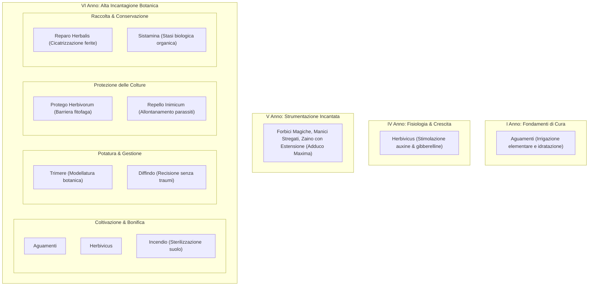

# 🌿 Compendio Accademico di Erbologia Magica & Formule Botaniche
**Dalla cattedra di Erbologia della Scuola di Magia e Stregoneria di Hogwarts**  
*A cura del Professor Nicholas Kelleher — Trattato Ufficiale di Botanica Magica*

---

> [!NOTE]
> Il presente compendio unifica l'estrazione accademica degli incantesimi, delle formule operative e dei presidi magici contenuti nel ***Manuale di Erbologia*** (*Nicholas Kelleher*), associando ciascuna formula al rispettivo anno di corso didattico (I - VII Anno), con le relative valenze pitagoriche calcolate secondo il *Codex Arithmantiae*.

---

## 📅 1. Classificazione degli Incantesimi per Anno Accademico

---

### 1. I ANNO — FONDAMENTI DI CURA ED IRRIGAZIONE
* **`Aguamenti`** (Formula: `Aguamenti`)
  * **Anno Didattico**: **I Anno** *(Capitolo: Strumentazioni e cura delle Piante, pag. 64)*
  * **Tipologia**: *Elementale Acqua / Irrigazione Botanica*
  * **Valenza Pitagorica**: **1** *(Somma 37 $\rightarrow 3+7=10 \rightarrow 1$)* — **Valenza Opposta**: **9** *(Circonferenza)*
  * **Applicazione**: Utilizzato dai giovani maghi fin dal primo anno al posto dell'annaffiatoio babbano per garantire l'apporto idrico calibrato alle specie botaniche più idrofile o in ambienti aridi.

---

### 2. IV ANNO — FISIOLOGIA VEGETALE E STIMOLAZIONE DELLA CRESCITA
* **`Herbivicus`** (Formula: `Herbivicus`)
  * **Anno Didattico**: **IV Anno** *(Capitolo dedicato: Incanto Herbivicus, pag. 173; in raccordo con Auxine & Gibberelline)*
  * **Tipologia**: *Incantesimo Botanico di Crescita / Accelerazione Fisiologica*
  * **Idoneità al Duello**: **NO** *(Formula ad uso agricolo e terapeutico)*
  * **Valenza Pitagorica**: **8** *(Somma 53 $\rightarrow 5+3=8$)* — **Valenza Opposta**: **2** *(Ottagono regolare)*
  * **Applicazione**: Stimola l'attività meristematica apicale promuovendo l'allungamento e la divisione cellulare delle piante. Interviene nella fioritura precoce, nello sviluppo radicale e nel contrasto alle forme di nanismo vegetale.

---

### 3. V ANNO — APPLICAZIONI AD INCANTESIMI DI STRUMENTAZIONE
* Nel V Anno il manuale approfondisce gli strumenti magici incantati:
  * **Forbici da Potatura Magiche**: intrise di formule di rifilatura perenne che garantiscono tagli netti senza alterare la fisiologia dei tessuti.
  * **Bacinelle da Irrigazione con Manico Incantato**: incantate per un dosaggio idrico costante, fluido e privo di sprechi.
  * **Zaino da Erbologia con Spazio Esteso**: applicazione dell'Incantesimo di Estensione Irriconoscibile (*Adduco Maxima*) per lo stoccaggio modulare di attrezzi e campioni ingombranti.

---

### 4. VI ANNO (M.A.G.O.) — IL CORPUS DEGLI INCANTESIMI IN ERBOLOGIA
Nel Sesto Anno il manuale dedica un trattato metodologico suddiviso in **quattro settori operativi** (pagg. 217–228):

#### Settore A: Coltivazione e Cura delle Piante
1. **`Aguamenti`** (Formula: `Aguamenti`):
   * *Valenza 1 (Opposto 9)*. Irrigazione intensiva di piante di medie e grandi dimensioni in condizioni di forte siccità.
2. **`Herbivicus`** (Formula: `Herbivicus`):
   * *Valenza 8 (Opposto 2)*. Riassunto e perfezionato come formula cardine per la crescita accelerata nell'Erbologia pratica.
3. **`Incendio`** (Formula: `Incendio`):
   * *Tipologia*: *Eradicazione Rapida & Bonifica del Suolo*
   * *Valenza Pitagorica*: **1** *(Somma 46 $\rightarrow 10 \rightarrow 1$)* — **Valenza Opposta**: **9** *(Circonferenza)*
   * *Applicazione*: Risorsa strategica impiegata per bonificare e sterilizzare porzioni di terreno da infestanti aggressive, distruggendo i nidi di parassiti senza alterare la chimica del suolo sottostante.

#### Settore B: Potatura e Gestione delle Piante
4. **`Trimere`** (Formula: `Trimere`):
   * *Definizione*: *Formula di Modellatura Botanica*
   * *Idoneità al Duello*: **NO**
   * *Valenza Pitagorica*: **7** *(Somma 43 $\rightarrow 4+3=7$)* — **Valenza Opposta**: **3** *(Ettagono regolare)*
   * *Applicazione*: Consente di sagomare e rifilare le chiome con chirurgica accuratezza. Argina lo sviluppo incontrollato di specie rampicanti o invasive mantenendole nei limiti geometrici di sicurezza.
5. **`Diffindo`** (Formula: `Diffindo`):
   * *Definizione*: *Formula di Recisione Botanica*
   * *Idoneità al Duello*: **SÌ** *(per taglio fustigante o disarmo in altri contesti)*
   * *Valenza Pitagorica*: **4** *(Somma 49 $\rightarrow 13 \rightarrow 4$)* — **Valenza Opposta**: **6** *(Quadrato)*
   * *Applicazione*: Taglio netto e istantaneo di fusti spessi e ramificazioni legnose senza traumi o sfilacciamenti. Cruciale per campioni velenosi (es. Tentacula) o urticanti, operando a distanza senza contatto epidermico.

#### Settore C: Protezione delle Piante
6. **`Protego Herbivorum`** (Formula: `Protego Herbivorum`):
   * *Definizione*: *Barriera contro la Fauna Fitofaga*
   * *Idoneità al Duello*: **NO**
   * *Valenza Pitagorica*: **2** *(Somma 101 $\rightarrow 2$)* — **Valenza Opposta**: **8** *(Angolo / Linea)*
   * *Applicazione*: Proietta un campo di forza protettivo invisibile attorno all'esemplare vegetale, respingendo insetti xilofagi, creature erbivore e parassiti ghiotti di linfa magica (fondamentale per proteggere le piantine giovani di Mandragola).
7. **`Repello Inimicum`** (Formula: `Repello Inimicum`):
   * *Definizione*: *Formula di Allontanamento Parassitario e Disinfestazione*
   * *Idoneità al Duello*: **NO**
   * *Valenza Pitagorica*: **3** *(Somma 84 $\rightarrow 12 \rightarrow 3$)* — **Valenza Opposta**: **7** *(Triangolo equilatero)*
   * *Applicazione*: Genera una frequenza oscillatoria repulsiva che disinfesta gli esemplari più delicati allontanando acari e parassiti fitopatogeni senza intossicare i tessuti della pianta.

#### Settore D: Raccolta e Conservazione delle Piante
8. **`Reparo Herbalis`** (Formula: `Reparo Herbalis`):
   * *Definizione*: *Formula di Rigenerazione Vegetale e Cicatrizzazione*
   * *Idoneità al Duello*: **NO**
   * *Valenza Pitagorica*: **3** *(Somma 75 $\rightarrow 12 \rightarrow 3$)* — **Valenza Opposta**: **7** *(Triangolo equilatero)*
   * *Applicazione*: Rimargina tempestivamente lesioni, ferite da taglio e sfilacciamenti provocati durante la potatura o la raccolta di campioni; risana la corteccia e i vasi linfatici, stimolando la cicatrizzazione istantanea e azzerando lo stress strutturale della pianta.
9. **`Sistamina`** (Formula: `Sistamina`):
   * *Definizione*: *Formula di Conservazione Organica e Blocco del Decadimento*
   * *Idoneità al Duello*: **NO**
   * *Valenza Pitagorica*: **6** *(Somma 33 $\rightarrow 3+3=6$)* — **Valenza Opposta**: **4** *(Esagono regolare)*
   * *Applicazione*: Congela temporaneamente il decadimento biologico e l'essiccazione spontanea della materia fresca appena colta. Mantiene integre le essenze vitali e i principi alchemici attivi per lo stoccaggio a lungo termine di foglie, radici e frutti destinati a pozioni o preparati tardivi.

---

### 5. VII ANNO — ALTA BOTANICA E SPECIE SUPERIORI
Nel VII Anno, il manuale non introduce nuove formule verbali, ma si concentra sulla gestione, sulle proprietà alchemiche e sulla manipolazione sicura delle **piante magiche di grado supremo**:
* *Ramoscelli di Valeriana*, *Albero Rigenerante*, *Puzzalinfa di Mimbulus*, *Ortiche Secche*, *Frullobulbo*, *Assenzio*, *Radice di Zenzero*, *Algabranchia*, *Achillea*, *Asfodelo* e *Levistico*.

---

## 📊 2. Tavola Sinottica degli Incantesimi di Erbologia

| Anno | Nome Incantesimo | Formula Verbale | Valenza | Opposto | Ramo Operativo | Effetto Chiave |
|:---:|---|---|:---:|:---:|---|---|
| **I** | **Idratazione Base** | `Aguamenti` | **1** | 9 | Irrigazione Elementare | Getto d'acqua calibrato per semenzai e piantine |
| **IV** | **Incanto di Crescita** | `Herbivicus` | **8** | 2 | Fisiologia & Crescita | Stimolazione ormonale di auxine e gibberelline |
| **VI** | **Bonifica del Terreno** | `Incendio` | **1** | 9 | Coltivazione & Cura | Sterilizzazione suolo ed eliminazione erbe infestanti |
| **VI** | **Modellatura Botanica** | `Trimere` | **7** | 3 | Potatura & Gestione | Sagomatura chiome e contenimento specie invasive |
| **VI** | **Recisione Chirurgica** | `Diffindo` | **4** | 6 | Potatura & Gestione | Taglio netto di fusti e radici senza sfilacciamenti |
| **VI** | **Barriera Fitofaga** | `Protego Herbivorum` | **2** | 8 | Difesa delle Piante | Schermo respingente contro fauna erbivora e parassiti |
| **VI** | **Allontanamento Parassiti** | `Repello Inimicum` | **3** | 7 | Difesa delle Piante | Frequenza repulsiva per disinfestazione innocua |
| **VI** | **Cicatrizzazione Vegetale** | `Reparo Herbalis` | **3** | 7 | Raccolta & Conservazione | Rimarginazione rapida di ferite e lesioni da taglio |
| **VI** | **Stasi Biologica** | `Sistamina` | **6** | 4 | Raccolta & Conservazione | Blocco del decadimento biologico di materia fresca |
