# 📜 Compendio delle Discipline Magiche: Creature, Piante e Pozioni

**Scuola di Magia e Stregoneria di Hogwarts**  
*Manuale Didattico Unificato delle Materie Pratiche (Anni I – VII)*

---

## 🏛️ 1. Struttura del Nuovo Portale Clone (`materie.html`)

Il nuovo portale clone dedicato ai test delle tre discipline pratiche è stato sviluppato con la medesima estetica (parchment dark glassmorphism, Cinzel, Tailwind e interattività) del portale principale degli incantesimi, con le seguenti caratteristiche fondanti:
- **3 Macro-Categorie Esclusive**:
  1. 🐉 **Creature Magiche** (*Manuale di Cura delle Creature Magiche* — Martina Mills)
  2. 🌿 **Erbologia & Piante** (*Manuale di Erbologia* — Canva)
  3. 🧪 **Arte delle Pozioni** (*Advanced Potion Making* — Libatius Borage)
- **Suddivisione Didattica per Anno di Corso (I – VII Anno o Totale)** per ciascuna macro-categoria.
- **Assenza Totale della Valenza Aritmantica** (riservata unicamente ad Incantesimi ed Aritmanzia).
- **Filtri Specifici Dinamici**:
  - Per le *Creature*: filtro per **Classificazione Ministeriale** (*X, XX, XXX, XXXX, XXXXX*).
  - Per le *Piante*: filtro per **Tipologia Botanica** (*Rimedio, Velenose, Antropomorfe, Alteratrici, Avanzate, Strumenti, Formule*).
  - Per le *Pozioni*: filtro per **Tipologia Alchemica** (*Curativa, Trasformante, Alteratrice, Veleno, Antidoto, Filtro d'Amore, Elisir, Per Oggetti, Oscura/Illegale*).
- **Ricerca Live Full-Text**: ricerca istantanea su nomi, sinonimi, ingredienti, habitat, proprietà ed effetti.
- **Modale Interattivo di Dettaglio**: visualizzazione completa con ricette numerate passo-passo, precauzioni, avvertenze critiche e note storiche.
- **Collegamento Bidirezionale**: navigazione immediata tra il portale Incantesimi & Rune ([`index.html`](file:///Users/andreamorachioli/.gemini/antigravity/scratch/portale-incantesimi/index.html)) e il nuovo portale Materie ([`materie.html`](file:///Users/andreamorachioli/.gemini/antigravity/scratch/portale-incantesimi/materie.html)).

---

## 📊 2. Distribuzione Statistica del Compendio

| Macro-Categoria | Totale Voci | Anni Didattici Coperti | Parametri Specifici |
| :--- | :--- | :--- | :--- |
| 🐉 **Creature Magiche** | **74** | III, IV, V, VI, VII Anno | Classificazione Ministeriale (X – XXXXX), Habitat, Dieta, Commerciabilità (Classe A, B) |
| 🌿 **Erbologia & Piante** | **57** | I, II, III, IV, V, VI, VII Anno | Tipologia Botanica, Parti Utilizzate, Proprietà, Coltivazione & Cura, Usi Pozionistici |
| 🧪 **Arte delle Pozioni** | **132** | I, II, III, IV, V, VI, VII Anno | Tipologia Alchemica, Colore Finale, Tempo di Preparazione, Ingredienti, Procedura Numerata, Avvertenze |
| **TOTALE ARCHIVIO** | **263** | **I – VII Anno** | **Nessuna Valenza Aritmantica** |

---

### Dettaglio Suddivisione per Anno

```mermaid
flowchart TD
    subgraph Totale["Compendio Materie: 263 Voci"]
        Creature["🐉 Creature: 74 voci"]
        Piante["🌿 Piante: 57 voci"]
        Pozioni["🧪 Pozioni: 132 voci"]
    end
    
    Creature --> C_III["III Anno: 2"]
    Creature --> C_IV["IV Anno: 9"]
    Creature --> C_V["V Anno: 25"]
    Creature --> C_VI["VI Anno: 26"]
    Creature --> C_VII["VII Anno: 12"]
    
    Piante --> P_I["I Anno: 9"]
    Piante --> P_II["II Anno: 7"]
    Piante --> P_III["III Anno: 7"]
    Piante --> P_IV["IV Anno: 11"]
    Piante --> P_V["V Anno: 8"]
    Piante --> P_VI["VI Anno: 4"]
    Piante --> P_VII["VII Anno: 11"]
    
    Pozioni --> Pot_I["I Anno: 1"]
    Pozioni --> Pot_II["II Anno: 27"]
    Pozioni --> Pot_III["III Anno: 26"]
    Pozioni --> Pot_IV["IV Anno: 30"]
    Pozioni --> Pot_V["V Anno: 19"]
    Pozioni --> Pot_VI["VI Anno: 16"]
    Pozioni --> Pot_VII["VII Anno: 13"]
```

---

## 🗂️ 3. File Generati e Posizione nel Repository

- **Pagina Clone Principale**: [materie.html](file:///Users/andreamorachioli/.gemini/antigravity/scratch/portale-incantesimi/materie.html)
- **Logica Applicativa**: [materieApp.js](file:///Users/andreamorachioli/.gemini/antigravity/scratch/portale-incantesimi/materieApp.js)
- **Dataset Unificato**: [materieData.js](file:///Users/andreamorachioli/.gemini/antigravity/scratch/portale-incantesimi/materieData.js)
- **Versione Standalone Autoconsistente**: [dist/materie_standalone.html](file:///Users/andreamorachioli/.gemini/antigravity/scratch/portale-incantesimi/dist/materie_standalone.html)
- **Suite di Test**: [scratch/test_materie_portal.js](file:///Users/andreamorachioli/.gemini/antigravity/scratch/portale-incantesimi/scratch/test_materie_portal.js) (Eseguita e validata con successo).
