# 📜 Compendio delle Discipline Magiche: Creature, Piante e Pozioni

**Scuola di Magia e Stregoneria di Hogwarts**  
*Manuale Didattico Unificato delle Materie Pratiche (Anni I – VII e Altri)*

---

## 🏛️ 1. Struttura del Portale Clone (`materie.html`)

Il portale clone dedicato alle tre discipline pratiche è stato sviluppato con la medesima estetica (parchment dark glassmorphism, Cinzel, Tailwind e interattività) del portale principale degli incantesimi, con le seguenti caratteristiche fondanti:
- **3 Macro-Categorie Esclusive**:
  1. 🐉 **Creature Magiche** (*Manuale di Cura delle Creature Magiche* — Martina Mills)
  2. 🌿 **Erbologia & Piante** (*Manuale di Erbologia* — Canva)
  3. 🧪 **Arte delle Pozioni** (*Advanced Potion Making* — Libatius Borage & Formule Speciali)
- **Suddivisione Didattica per Anno di Corso (I – VII Anno, Altri o Totale)** per ciascuna macro-categoria.
- **Assenza Totale della Valenza Aritmantica** (riservata unicamente ad Incantesimi ed Aritmanzia).
- **Filtri Specifici Dinamici**:
  - Per le *Creature*: filtro per **Classificazione Ministeriale** (*X, XX, XXX, XXXX, XXXXX*).
  - Per le *Piante*: filtro per **Tipologia Botanica** (*Rimedio, Velenose, Antropomorfe, Alteratrici, Avanzate, Strumenti, Formule, Bonifica*).
  - Per le *Pozioni*: filtro per **Tipologia Alchemica** (*Curativa, Trasformante, Alteratrice, Veleno, Antidoto, Filtro d'Amore, Elisir, Soporifera, Per Oggetti / Strumentazione, Cosmetica, Veterinaria, Oscura/Illegale*).
- **Ricerca Live Full-Text**: ricerca istantanea su nomi, sinonimi, ingredienti, habitat, proprietà ed effetti.
- **Modale Interattivo di Dettaglio**: visualizzazione completa con ricette numerate passo-passo, precauzioni, avvertenze critiche e note storiche.
- **Collegamento Bidirezionale**: navigazione immediata tra il portale Incantesimi & Rune ([`index.html`](file:///Users/andreamorachioli/.gemini/antigravity/scratch/portale-incantesimi/index.html)) e il portale Materie ([`materie.html`](file:///Users/andreamorachioli/.gemini/antigravity/scratch/portale-incantesimi/materie.html)).

---

## 📊 2. Distribuzione Statistica del Compendio

| Macro-Categoria | Totale Voci | Anni Didattici Coperti | Parametri Specifici |
| :--- | :--- | :--- | :--- |
| 🐉 **Creature Magiche** | **74** | III, IV, V, VI, VII Anno | Classificazione Ministeriale (X – XXXXX), Habitat, Dieta, Commerciabilità (Classe A, B) |
| 🌿 **Erbologia & Piante** | **57** | I, II, III, IV, V, VI, VII Anno | Tipologia Botanica, Parti Utilizzate, Proprietà, Coltivazione & Cura, Usi Pozionistici |
| 🧪 **Arte delle Pozioni** | **138** | I – VII Anno + **Altri** (6 speciali) | Tipologia Alchemica, Colore Finale, Tempo di Preparazione, Ingredienti, Procedura Numerata, Avvertenze |
| **TOTALE ARCHIVIO** | **269** | **I – VII Anno & Altri** | **Nessuna Valenza Aritmantica** |

---

### Dettaglio Suddivisione per Anno

```mermaid
flowchart TD
    subgraph Totale["Compendio Materie: 269 Voci"]
        Creature["🐉 Creature: 74 voci"]
        Piante["🌿 Piante: 57 voci"]
        Pozioni["🧪 Pozioni: 138 voci"]
    end
    
    Creature --> C_III["III Anno: 2"]
    Creature --> C_IV["IV Anno: 9"]
    Creature --> C_V["V Anno: 25"]
    Creature --> C_VI["VI Anno: 26"]
    Creature --> C_VII["VII Anno: 12"]
    
    Piante --> P_I["I Anno: 9"]
    Piante --> P_II["II Anno: 7"]
    Piante --> P_III["III Anno: 7"]
    Piante --> P_IV["IV Anno: 11"]
    Piante --> P_V["V Anno: 8"]
    Piante --> P_VI["VI Anno: 4"]
    Piante --> P_VII["VII Anno: 11"]
    
    Pozioni --> Pot_0["Altri (Speciali): 6"]
    Pozioni --> Pot_I["I Anno: 1"]
    Pozioni --> Pot_II["II Anno: 27"]
    Pozioni --> Pot_III["III Anno: 26"]
    Pozioni --> Pot_IV["IV Anno: 30"]
    Pozioni --> Pot_V["V Anno: 19"]
    Pozioni --> Pot_VI["VI Anno: 16"]
    Pozioni --> Pot_VII["VII Anno: 13"]
```

---

## 🧪 3. Pozioni & Strumentazioni Inserite in "Altri"

Le 6 formule e manufatti collocati nella categoria didattica **Altri** (`anno: 0`) costituiscono preparazioni avanzate, semilavorati e presidi alchemici speciali:

1. **Elisir dell'Indomito** *(Harvey Specter, 2026)*:
   - **Tipologia**: Alteratrice di Stato / Potenziamento / Resistenza Fisica Estrema.
   - **Ingrediente Focale**: Dente di Graphorn intero (frantumato in schegge, non polverizzato), Fiele di Armadillo, Succo di Fire Crab, Sangue di Re'em (3 gocce), Essenza di Dittamo.
   - **Effetti**: Soppressione totale del dolore e indurimento dermico temporaneo; trasforma il bevitore in un *juggernaut* in grado di ignorare ferite e respingere fatture minori.
   - **Sigillatura Fisica**: Immersione finale di una barra di ferro freddo per 3 secondi.
   - **Avvertenze**: "Crollo" psicofisico con perdita di empatia e pensiero razionale ("visione a tunnel"); impossibile lanciare incantesimi di precisione; pericolo di lacerazioni muscolari interne.

2. **Elisir Solis Igniti** *(Harvey Specter & Alfred Knight, 2026)*:
   - **Tipologia**: Curativa Suprema / Rigenerazione Mirata & Oftalmica.
   - **Ingrediente Focale**: Lacrima di Fenice pura, Fiori di Moly essiccati (azione isolante), Filtro di Eufrasia, Corno di Bicorno polverizzato, Radice di Mandragora matura, Spire di Artemisia, Acqua di Luna.
   - **Effetti**: Conduttore rigenerativo ad ampio spettro per tessuti cutanei, muscolari ed ossei distrutti da incantesimi offensivi; scioglie residui magici corrosivi di maledizioni oscure; ripara cornee e nervi ottici compromessi da fiamme o acidi restituendo completamente la vista (ispirato al recupero della vista della Vicepreside Lorraine Muriel Mhara).
   - **Avvertenze**: Richiede calderone in oro o metalli nobili; divieto assoluto di mescolanza con ingredienti oscuri; dosaggio micrometrico controllato.

3. **Filtro di Eufrasia** *(Harvey Specter, 2026)*:
   - **Tipologia**: Curativa / Base Alchemica Semilavorata / Oftalmica.
   - **Ingredienti**: Fiori freschi di Eufrasia (10, raccolti all'alba con rugiada), Pietra di Luna in polvere, Acqua sorgiva pura (150 ml), filtrato con garza di ortica.
   - **Funzione**: Agisce da catalizzatore di luce concentrando le proprietà rigeneratrici del fiore per composti complessi sulla vista (come l'Elisir Solis Igniti); amplifica la ricettività sensoriale oculare.

4. **Pozione Somnus** *(Harvey Specter & Alfred Knight, 2026)*:
   - **Tipologia**: Alteratrice di Stato / Psicoattiva / Onirica & Sonno Indotto.
   - **Ingredienti**: Alihotsy macinato finemente a pioggia, Infuso di Lavanda, Polvere di Asfodelo, Essenza di Valeriana, Muco di Vermicoli, Pietra di Luna, Capello del destinatario (opzionale/consigliato).
   - **Effetti**: Inversione di polarità dell'Alihotsy da isterica a profondamente introspettiva; conduttore psichico per stati di sogno lucido e vivido prolungato.
   - **Chiusura Obbligatoria**: Conclusa tassativamente con l'incantesimo **Morfèus** per guidare e stabilizzare il flusso dei sogni ed evitare degenerazioni caotiche.

5. **Pozione Zitto-e-lava** *(Harvey M. Specter, 2026)*:
   - **Tipologia**: Per Oggetti / Detersione Estrema / Disincrostante Botanico.
   - **Ingredienti**: Pus puro di Bubotubero (300 ml, lavorato a freddo con moto vorticoso), Cristalli di sale marino grosso, Linfa di corteccia o Frullobulbo, Macerato di Timo selvatico, Alcool puro distillato (opzionale).
   - **Effetti**: Inverte la causticità del pus trasformandolo in un potente solvente alchemico da contatto per pavimentazioni secolari e pietre da serra; rimuove depositi organici decennali e colonie fungine senza intaccare la malta.
   - **Sinergia Magica**: Straordinaria reazione con **Tergeo** e **Scourgify** per assorbire ed eliminare istantaneamente residui melmosi e liquido esausto.

6. **Garza di Ortica** *(Manufatto Tessile Alchemico Tradizionale)*:
   - **Tipologia**: Per Oggetti / Strumentazione Alchemica / Filtro Purificante & Bendaggio.
   - **Ingredienti & Strumenti**: Fusti di Ortica matura freschi (5), Acqua sorgiva (150 ml), Cenere di legno di Quercia (1 tazza); coltello d'argento affilato, mazzuolo di legno, pettine a denti fitti (in legno o osso), guanti in pelle di drago, piccolo telaio da tessitura (o bacchetta magica).
   - **Funzione & Proprietà**: Manufatto tessile a trama rada ricavato dalle fibre liberiane interne dell'ortica macerate in cenere di quercia. Straordinaria resistenza chimica e carica magica purificante: è lo strumento d'elezione per il filtro di infusi acidi, corrosivi o per uso oculare (come il Filtro di Eufrasia), nonché bendaggio sterile che previene il rigetto magico dei tessuti rigenerati. Non assorbe né altera i principi attivi delle pozioni filtrate.

---

## 🗂️ 4. File Generati e Posizione nel Repository

- **Pagina Clone Principale**: [materie.html](file:///Users/andreamorachioli/.gemini/antigravity/scratch/portale-incantesimi/materie.html)
- **Logica Applicativa**: [materieApp.js](file:///Users/andreamorachioli/.gemini/antigravity/scratch/portale-incantesimi/materieApp.js)
- **Dataset Unificato**: [materieData.js](file:///Users/andreamorachioli/.gemini/antigravity/scratch/portale-incantesimi/materieData.js)
- **Versione Standalone Autoconsistente**: [dist/materie_standalone.html](file:///Users/andreamorachioli/.gemini/antigravity/scratch/portale-incantesimi/dist/materie_standalone.html)
- **Suite di Test**: [scratch/test_materie_interaction.js](file:///Users/andreamorachioli/.gemini/antigravity/scratch/portale-incantesimi/scratch/test_materie_interaction.js) e [scratch/test_materie_portal.js](file:///Users/andreamorachioli/.gemini/antigravity/scratch/portale-incantesimi/scratch/test_materie_portal.js) (Eseguite e validate con successo).
