# 🪄 Compendio Accademico di Trasfigurazione Magica
**Dalla cattedra di Trasfigurazione della Scuola di Magia e Stregoneria di Hogwarts**  
*Sincronizzato con il Programma Ufficiale di Studio di Arcane GDR (I - VII Anno)*

---

> [!NOTE]
> Il presente compendio formalizza la classificazione curricolare e metodologica della **Trasfigurazione**, strutturata dal I al VII Anno di corso secondo il Registro Ufficiale dei Docenti di Hogwarts e la cattedra di Trasfigurazione (*Yashiro Isana Mortem*).
> 
> Per ciascun anno didattico vengono dettagliati i moduli di **Teoria** e il corpus delle formule operative di **Pratica**, con relative valenze pitagoriche, simmetrie speculari, figure geometriche operative (*Signo*) e corrispondenze con l'Antico Futhark.

---

## 📅 Quadro Sinottico del Programma Didattico (I - VII Anno)

```mermaid
flowchart TD
    subgraph I_Anno["I Anno: Fondamenti Molecolari & Forme"]
        T1["Teoria: Parametri (Spazio, Struttura, Colore, Tonalità, Essenza), Leggi/Divieti di Gamp, Controincanti"]
        P1["Pratica: Chartanimus | Formule Base: Transfiguro, Muto, Verto"]
    end

    subgraph II_Anno["II Anno: Trasfigurazione Inanimata"]
        T2["Teoria: Caratteristiche della Trasfigurazione Inanimata"]
        P2["Pratica: Acutus, Malum, Gommosus, Vermiculus, Snufflifors, Incarcifors, Feraverto, Inferacus"]
    end

    subgraph III_Anno["III Anno: Detrasfigurazione & Difesa"]
        T3["Teoria: Detrasfigurazione, Difesa Non-Verbale, Bivalenza negli Incanti"]
        P3["Pratica: Reparifarge, Lapifors, Avifors, Avis, Farfallus Explodit, Furunculus, Glisseo"]
    end

    subgraph IV_Anno["IV Anno: Trasfigurazione Animata & Litotrasfigurazione"]
        T4["Teoria: Litotrasfigurazione, Trasfigurazione Animata, Paradosso della Trasfigurazione"]
        P4["Pratica: Draconifors, Duro, Piertotum Locomotor, Engorgio e Diminuendo"]
    end

    subgraph V_Anno["V Anno: Evocazione & Evanescenza"]
        T5["Teoria: Principi di Evocazione ed Evanescenza, Duplicazione, Incanto Anti-furto, Demone Stalker"]
        P5["Pratica: Demone Stalker (Teoria), Epoximise, Orchideus, Melofors, Incarceramus"]
    end

    subgraph VI_Anno["VI Anno: Trasfigurazione Umana & Pieghe Spazio-Temporali"]
        T6["Teoria: Estensione Irriconoscibile (Adduco Maxima), Tassonomia, Trasfigurazione Circolare, T. Umana"]
        P6["Pratica: Crinus Muto, Pullus, Densaugeo, Paperante, Piscofors, Entomorphis, Furitum, Geminio, Inflatus"]
    end

    subgraph VII_Anno["VII Anno: Animagia Suprema & Ripristino"]
        T7["Teoria: Animagia, Animagus, Licantropia/Mannarismo, Maledictus, Metamorphomagus"]
        P7["Pratica: Animaleus Nobodyx (Teoria), Pozione/Incanto Homine Reverto (Reverto)"]
    end

    I_Anno --> II_Anno --> III_Anno --> IV_Anno --> V_Anno --> VI_Anno --> VII_Anno
```

---

## 🏛️ 1. I ANNO — FONDAMENTI MOLECOLARI E TRASFORMAZIONE DI BASE

### Modulo di Teoria
1. **La concentrazione**: orientamento mentale e focalizzazione dell'intento.
2. **Parametri Fondamentali**:
   - **Spazio**: volume, ingombro tridimensionale e collocazione del corpo.
   - **Struttura**: legami molecolari e densità della materia.
   - **Colore**: dispersione cromatica e pigmentazione superficiale.
   - **Tonalità**: timbro materico, risonanza e lucentezza.
   - **Essenza**: matrice spirituale, peso e inerzia magica.
3. **La perfezione Molecolare & La rifrazione**: allineamento degli atomi e reazione alla luce.
4. **Controincantesimi Trasfigurativi**: fondamenti della neutralizzazione delle alterazioni.
5. **Leggi e Divieti di Gamp**:
   - *Cinque Eccezioni Principali alla Legge di Gamp sulla Trasfigurazione degli Elementi* (impossibilità di creare cibo dal nulla, denaro reale, vita senziente, amore autentico o resuscitare i morti).
6. **La marchiatura animata ed inanimata**: sigillatura trasfigurativa della materia.
7. **Le Tre Branche di Trasfigurazione Elementare**:
   - *La Trasfigurazione che muta la forma di un oggetto* (`Transfiguro`).
   - *La Trasfigurazione che muta il materiale di un oggetto* (`Muto`).
   - *La Trasfigurazione totale di un oggetto* (`Verto`).

### Modulo di Pratica
* **`Chartanimus`** (Animazione di Carta)
  * *Formula*: `Chartanimus`
  * *Valenza Pitagorica*: **4** *(Somma 49 $\rightarrow 13 \rightarrow 4$)* — *Opposto*: **6** *(Quadrato)*
  * *Rune Associate*: ᚨ Ansuz (Pos. 4ª), ᛇ Eihwaz (Pos. 13ª), ᛜ Inguz (Pos. 22ª)
  * *Gesto*: Tocco lieve della punta della bacchetta al centro del foglio con sollevamento rapido.
  * *Effetto*: Anima fogli di pergamena o origami conferendo loro movimenti autonomi e sembianze di piccoli animali di carta.
* **`Transfiguro`** (Trasfigurazione Morfologica di Forma)
  * *Formula*: `Transfiguro` | *Valenza*: **8** (Opposto 2, Ottagono) | *Rune*: ᚹ Wunjo (8ª), ᛏ Teiwaz (17ª)
* **`Muto`** (Trasfigurazione Materica di Sostanza)
  * *Formula*: `Muto` | *Valenza*: **6** (Opposto 4, Esagono) | *Rune*: ᚲ Kenaz (6ª), ᛉ Algiz (15ª), ᛞ Dagaz (24ª)
* **`Verto`** (Trasfigurazione Totale)
  * *Formula*: `Verto` | *Valenza*: **6** (Opposto 4, Esagono) | *Rune*: ᚲ Kenaz (6ª), ᛉ Algiz (15ª), ᛞ Dagaz (24ª)

---

## 🏛️ 2. II ANNO — LA TRASFIGURAZIONE INANIMATA

### Modulo di Teoria
1. **La Trasfigurazione Inanimata**: transizione tra corpi privi di vita biologica; stabilità della massa e densità.
2. **Le caratteristiche della Trasfigurazione**: tempo di persistenza, decadimento trasfigurativo e saturazione magica.

### Modulo di Pratica
* **`Acutus`** (Trasfigurazione in Ago)
  * *Formula*: `Acutus` | *Valenza*: **2** (Opposto 8, Angolo/Linea) | *Rune*: ᚢ Uruz (2ª), ᛁ Isa (11ª), ᛗ Mannaz (20ª)
  * *Effetto*: Esercizio canonico: trasforma un fiammifero o scheggia di legno in un affilato ago d'acciaio.
* **`Malum`** (Trasfigurazione in Mela)
  * *Formula*: `Malum` | *Valenza*: **6** (Opposto 4, Esagono) | *Rune*: ᚲ Kenaz (6ª), ᛉ Algiz (15ª), ᛞ Dagaz (24ª)
* **`Gommosus`** (Incantesimo di Ammorbidimento)
  * *Formula*: `Gommosus` | *Valenza*: **1** (Opposto 9, Circonferenza) | *Rune*: ᚠ Fehu (1ª), ᚾ Nauthiz (10ª), ᛖ Ehwaz (19ª)
  * *Effetto*: Rende superfici solide gommose ed elastiche come trampolini, ammortizzando cadute o respingendo colpi.
* **`Vermiculus`** (Trasfigurazione in Lombrico)
  * *Formula*: `Vermiculus` | *Valenza*: **2** (Opposto 8, Angolo/Linea) | *Rune*: ᚢ Uruz (2ª), ᛁ Isa (11ª), ᛗ Mannaz (20ª)
* **`Snufflifors`** (Trasfigurazione in Topo)
  * *Formula*: `Snufflifors` | *Valenza*: **9** (Opposto 1, Ellisse) | *Rune*: ᚺ Hagalaz (9ª), ᛒ Berkana (18ª)
* **`Incarcifors`** (Trasfigurazione in Gabbia)
  * *Formula*: `Incarcifors` | *Valenza*: **8** (Opposto 2, Ottagono) | *Rune*: ᚹ Wunjo (8ª), ᛏ Teiwaz (17ª)
  * *Effetto*: Trasfigura oggetti circostanti in una gabbia di ferro o legno per imprigionare bersagli o creature.
* **`Feraverto`** (Trasfigurazione Animale in Calice)
  * *Formula*: `Feraverto` | *Valenza*: **5** (Opposto 5, Pentagono) | *Rune*: ᚱ Raido (5ª), ᛈ Perthr (14ª), ᛟ Othila (23ª), ○ Bianca
  * *Gesto*: Tre tocchi precisi della bacchetta sul dorso dell'animale.
  * *Effetto*: Converte un piccolo animale (es. topo o corvo) in un elegante calice d'acqua di cristallo.
* **`Inferacus`** (Trasfigurazione Riccio in Portaspilli)
  * *Formula*: `Inferacus` | *Valenza*: **1** (Opposto 9, Circonferenza) | *Rune*: ᚠ Fehu (1ª), ᚾ Nauthiz (10ª), ᛖ Ehwaz (19ª)

---

## 🏛️ 3. III ANNO — DETRASFIGURAZIONE E BIVALENZA

### Modulo di Teoria
1. **Detrasfigurazione**: tecniche di ripristino dell'ordine molecolare primitivo e scomposizione degli incanti innestati.
2. **Difesa Non-Verbale**: schermatura del pensiero trasfigurativo per prevenire contro-sorti avversarie.
3. **Bivalenza negli Incanti**: formule a duplice polarità operativa (difesa/offesa, materia/inerzia).

### Modulo di Pratica
* **`Reparifarge`** (Incantesimo di Rettifica Trasfigurativa / Detrasfigurazione)
  * *Formula*: `Reparifarge` | *Valenza*: **6** (Opposto 4, Esagono) | *Rune*: ᚲ Kenaz (6ª), ᛉ Algiz (15ª), ᛞ Dagaz (24ª)
  * *Effetto*: Il controincanto principe della disciplina: annulla trasfigurazioni parziali, imperfette o andate storte.
* **`Lapifors`** (Trasfigurazione in Coniglio)
  * *Formula*: `Lapifors` | *Valenza*: **9** (Opposto 1, Ellisse) | *Rune*: ᚺ Hagalaz (9ª), ᛒ Berkana (18ª)
* **`Avifors`** (Trasfigurazione in Volatile)
  * *Formula*: `Avifors` | *Valenza*: **7** (Opposto 3, Ettagono) | *Rune*: ᚷ Gebo (7ª), ᛋ Sowilo (16ª)
* **`Avis`** (Evocazione di Stormo d'Uccelli)
  * *Formula*: `Avis` | *Valenza*: **5** (Opposto 5, Pentagono) | *Rune*: ᚱ Raido (5ª), ᛈ Perthr (14ª), ᛟ Othila (23ª), ○ Bianca
  * *Effetto*: Evoca un turbine di piccoli uccellini cinguettanti dalla punta della bacchetta.
* **`Farfallus Explodit`** (Evocazione Farfalle Luminose)
  * *Formula*: `Farfallus Explodit` | *Valenza*: **7** (Opposto 3, Ettagono) | *Rune*: ᚷ Gebo (7ª), ᛋ Sowilo (16ª)
* **`Furunculus`** (Fattura dei Foruncoli)
  * *Formula*: `Furunculus` | *Valenza*: **1** (Opposto 9, Circonferenza) | *Rune*: ᚠ Fehu (1ª), ᚾ Nauthiz (10ª), ᛖ Ehwaz (19ª)
* **`Glisseo`** (Incantesimo Leviga-Scale)
  * *Formula*: `Glisseo` | *Valenza*: **6** (Opposto 4, Esagono) | *Rune*: ᚲ Kenaz (6ª), ᛉ Algiz (15ª), ᛞ Dagaz (24ª)
  * *Effetto*: Rende gradini o piani inclinati perfettamente lisci come scivoli d'ardesia.

---

## 🏛️ 4. IV ANNO — LITOTRASFIGURAZIONE E TRASFIGURAZIONE ANIMATA

### Modulo di Teoria
1. **Litotrasfigurazione**: manipolazione della materia minerale, pietra dura, marmo e metalli pesanti.
2. **Trasfigurazione Animata**: infusione di schemi motori biologici in costrutti minerali o lignei.
3. **Paradosso della Trasfigurazione**: tensione energetica tra materia originale e materia impressa.

### Modulo di Pratica
* **`Draconifors`** (Animazione Draconica)
  * *Formula*: `Draconifors` | *Valenza*: **1** (Opposto 9, Circonferenza) | *Rune*: ᚠ Fehu (1ª), ᚾ Nauthiz (10ª), ᛖ Ehwaz (19ª)
  * *Effetto*: Trasforma statuette o effigi in minuscoli draghetti animati capaci di sputare piccole fiammelle.
* **`Duro`** (Incantesimo Pietrificante di Cose)
  * *Formula*: `Duro` | *Valenza*: **4** (Opposto 6, Quadrato) | *Rune*: ᚨ Ansuz (4ª), ᛇ Eihwaz (13ª), ᛜ Inguz (22ª)
  * *Effetto*: Converte all'istante materiali morbidi o flessibili (tessuti, arazzi, liquidi) in dura pietra massiccia.
* **`Piertotum Locomotor`** (Animazione di Statue e Armature)
  * *Formula*: `Piertotum Locomotor` | *Valenza*: **8** (Opposto 2, Ottagono) | *Rune*: ᚹ Wunjo (8ª), ᛏ Teiwaz (17ª)
  * *Effetto*: Alta animazione archetipica: dà vita a colossi di pietra e armature medievali chiamandoli a guardia del castello.
* **`Engorgio` & `Diminuendo`** (Ingrossamento e Rimpicciolimento)
  * *Formule*: `Engorgio` | `Diminuendo`
  * *Valenze Pitagoriche*: **9** *(Somma 54 $\rightarrow 9$ per entrambe)* — *Opposto*: **1** *(Ellisse)*
  * *Rune Associate*: ᚺ Hagalaz (Pos. 9ª), ᛒ Berkana (Pos. 18ª)
  * *Effetti*: Regolano la dilatazione e la contrazione volumetrica uniforme di corpi inanimati ed entità viventi.

---

## 🏛️ 5. V ANNO — EVOCAZIONE, EVANESCENZA E DUPLICAZIONE

### Modulo di Teoria
1. **Evocazione**: principi generali di materializzazione dal non-essere.
2. **Limiti del Demone Stalker**: confini etici e dimensionali dell'entità inseguente.
3. **La Duplicazione**: regole di riproduzione della materia (*Geminio*).
4. **Principi generali di Evanescenza**:
   - Evanescenza di corpi inanimati (*Evanesco*).
   - Evanescenza di piante ed esseri viventi superiori.
5. **Incantesimo Anti-furto**: sigilli di proprietà inalienabile applicati su beni trasfigurati.
6. **Demone Stalker [Teoria]**: fenomenologia della creatura evocata.

### Modulo di Pratica
* **`Epoximise`** (Incantesimo Adesivo / Incollante)
  * *Formula*: `Epoximise` | *Valenza*: **3** (Opposto 7, Triangolo equil.) | *Rune*: ᚦ Thurisaz (3ª), ᛃ Jera (12ª), ᛚ Laguz (21ª)
* **`Orchideus`** (Evocazione Floreale)
  * *Formula*: `Orchideus` | *Valenza*: **8** (Opposto 2, Ottagono) | *Rune*: ᚹ Wunjo (8ª), ᛏ Teiwaz (17ª)
* **`Melofors`** (Fattura della Zucca)
  * *Formula*: `Melofors` | *Valenza*: **8** (Opposto 2, Ottagono) | *Rune*: ᚹ Wunjo (8ª), ᛏ Teiwaz (17ª)
  * *Effetto*: Ingloba la testa dell'avversario all'interno di una pesante zucca matura.
* **`Incarceramus`** (Fattura delle Corde Vincolanti)
  * *Formula*: `Incarceramus` | *Valenza*: **6** (Opposto 4, Esagono) | *Rune*: ᚲ Kenaz (6ª), ᛉ Algiz (15ª), ᛞ Dagaz (24ª)
  * *Effetto*: Scaglia spesse corde magiche dalla bacchetta che si avvolgono e stringono attorno al bersaglio.

---

## 🏛️ 6. VI ANNO — TRASFIGURAZIONE UMANA E DISTORSIONI DELLO SPAZIO

### Modulo di Teoria
1. **Incantesimo di Estensione Irriconoscibile** (`Adduco Maxima`, Pagina 83 del Manuale): dilatazione dello spazio interno lasciando invariate le dimensioni esterne.
2. **Tassonomia della Trasformazione**: classificazione delle mutazioni inter-specie.
3. **Trasfigurazione Circolare** (`Obstringo Circulum`): loop ciclici di trasformazione periodica.
4. **Trasfigurazione Umana**: principi biologici di alterazione corporea su tessuti umani viventi.

### Modulo di Pratica
* **`Adduco Maxima`** (Estensione Irriconoscibile)
  * *Formula*: `Adduco Maxima` | *Valenza*: **7** (Opposto 3, Ettagono) | *Rune*: ᚷ Gebo (7ª), ᛋ Sowilo (16ª)
* **`Obstringo Circulum`** (Trasfigurazione Circolare Intermittente)
  * *Formula*: `Obstringo Circulum` | *Valenza*: **8** (Opposto 2, Ottagono) | *Rune*: ᚹ Wunjo (8ª), ᛏ Teiwaz (17ª)
* **`Crinus Muto`** (Trasfigurazione della Capigliatura)
  * *Formula*: `Crinus Muto` | *Valenza*: **3** (Opposto 7, Triangolo equil.) | *Rune*: ᚦ Thurisaz (3ª), ᛃ Jera (12ª), ᛚ Laguz (21ª)
* **`Pullus`** (Trasfigurazione in Pollo)
  * *Formula*: `Pullus` | *Valenza*: **2** (Opposto 8, Angolo/Linea) | *Rune*: ᚢ Uruz (2ª), ᛁ Isa (11ª), ᛗ Mannaz (20ª)
* **`Densaugeo`** (Fattura Cresci-Denti)
  * *Formula*: `Densaugeo` | *Valenza*: **9** (Opposto 1, Ellisse) | *Rune*: ᚺ Hagalaz (9ª), ᛒ Berkana (18ª)
* **`Paperate / Paperante`** (Trasfigurazione in Papera)
  * *Formula*: `Paperante` | *Valenza*: **8** (Opposto 2, Ottagono) | *Rune*: ᚹ Wunjo (8ª), ᛏ Teiwaz (17ª)
* **`Piscofors`** (Trasfigurazione in Pesce)
  * *Formula*: `Piscofors` | *Valenza*: **8** (Opposto 2, Ottagono) | *Rune*: ᚹ Wunjo (8ª), ᛏ Teiwaz (17ª)
* **`Entomorphis`** (Trasfigurazione Insettoide)
  * *Formula*: `Entomorphis` | *Valenza*: **9** (Opposto 1, Ellisse) | *Rune*: ᚺ Hagalaz (9ª), ᛒ Berkana (18ª)
* **`Furitum`** (Trasfigurazione in Furetto)
  * *Formula*: `Furitum` | *Valenza*: **5** (Opposto 5, Pentagono) | *Rune*: ᚱ Raido (5ª), ᛈ Perthr (14ª), ᛟ Othila (23ª), ○ Bianca
* **`Geminio`** (Duplicazione Trasfigurativa)
  * *Formula*: `Geminio` | *Valenza*: **5** (Opposto 5, Pentagono) | *Rune*: ᚱ Raido (5ª), ᛈ Perthr (14ª), ᛟ Othila (23ª), ○ Bianca
* **`Inflatus`** (Gonfiamento Corporeo a Palloncino)
  * *Formula*: `Inflatus` | *Valenza*: **8** (Opposto 2, Ottagono) | *Rune*: ᚹ Wunjo (8ª), ᛏ Teiwaz (17ª)

---

## 🏛️ 7. VII ANNO — ANIMAGIA SUPREMA E RITORNO ALLA FORMA UMANA

### Modulo di Teoria
1. **Animagia**: l'apice della Trasfigurazione umana; fusione della coscienza umana con la forma animale istintiva.
2. **Animagus**: il processo meditativo e rituale per svelare e padroneggiare la propria forma bestiale.
3. **Animagia e Licantropia / Mannarismo**: differenze sostanziali tra mutazione volontaria (Animagus) e infezione patologica indotta (Licantropia).
4. **Maledictus**: maledizioni di sangue trasmissibili per via matrilineare con trasformazione bestiale definitiva.
5. **Metamorphomagus**: facoltà innata e non apprendibile di mutare lineamenti e aspetto a piacimento.

### Modulo di Pratica
* **`Animaleus Nobodyx` [Teoria]** (Incantesimo di Ripristino Umano)
  * *Formula*: `Animaleus Nobodyx` | *Valenza*: **7** (Opposto 3, Ettagono) | *Rune*: ᚷ Gebo (7ª), ᛋ Sowilo (16ª)
  * *Effetto*: Sortilegio supremo per forzare un individuo trasfigurato o un Animagus a deporre la forma animale e riacquisire i tratti e la fisionomia umana originale.
* **`Reverto` / Pozione Homine Reverto [Teoria]** (Controincantesimo Trasfigurativo di Ritorno)
  * *Formula*: `Reverto` | *Valenza*: **6** (Opposto 4, Esagono) | *Rune*: ᚲ Kenaz (6ª), ᛉ Algiz (15ª), ᛞ Dagaz (24ª)
  * *Effetto*: Reverte istantaneamente mutazioni molecolari complesse, risanando l'involucro corporeo da deformazioni esterne.

---

## 📊 Tabella Sinottica Generale di Trasfigurazione (I - VII Anno)

| Anno | Nome Incanto | Formula | Val. | Opp. | Ramo Operativo | Idoneità Duello | Rune Associate (Futhark) |
|:---:|---|---|:---:|:---:|---|:---:|---|
| **I** | **Animazione di Carta** | `Chartanimus` | **4** | 6 | Animazione Inanimata Base | ⛔ NO | ᚨ Ansuz (4ª), ᛇ Eihwaz (13ª), ᛜ Inguz (22ª) |
| **I** | **Forma Morfologica** | `Transfiguro` | **8** | 2 | Trasfigurazione di Forma | ⛔ NO | ᚹ Wunjo (8ª), ᛏ Teiwaz (17ª) |
| **I** | **Sostanza Materica** | `Muto` | **6** | 4 | Trasfigurazione di Materiale | ⛔ NO | ᚲ Kenaz (6ª), ᛉ Algiz (15ª), ᛞ Dagaz (24ª) |
| **I** | **Trasfigurazione Totale** | `Verto` | **6** | 4 | Trasfigurazione Completa | ⛔ NO | ᚲ Kenaz (6ª), ᛉ Algiz (15ª), ᛞ Dagaz (24ª) |
| **II** | **Trasfigurazione in Ago** | `Acutus` | **2** | 8 | Trasfigurazione Inanimata | ⚔️ SÌ | ᚢ Uruz (2ª), ᛁ Isa (11ª), ᛗ Mannaz (20ª) |
| **II** | **Trasfigurazione in Mela** | `Malum` | **6** | 4 | Trasfigurazione Inanimata | ⛔ NO | ᚲ Kenaz (6ª), ᛉ Algiz (15ª), ᛞ Dagaz (24ª) |
| **II** | **Ammorbidimento** | `Gommosus` | **1** | 9 | Alterazione Materica Elastica | ⚔️ SÌ | ᚠ Fehu (1ª), ᚾ Nauthiz (10ª), ᛖ Ehwaz (19ª) |
| **II** | **Trasfigurazione in Lombrico** | `Vermiculus` | **2** | 8 | Trasfigurazione Organica Minore | ⚔️ SÌ | ᚢ Uruz (2ª), ᛁ Isa (11ª), ᛗ Mannaz (20ª) |
| **II** | **Trasfigurazione in Topo** | `Snufflifors` | **9** | 1 | Trasfigurazione Inanimato-Animale | ⚔️ SÌ | ᚺ Hagalaz (9ª), ᛒ Berkana (18ª) |
| **II** | **Trasfigurazione in Gabbia** | `Incarcifors` | **8** | 2 | Trasfigurazione Inanimata Contenitiva | ⚔️ SÌ | ᚹ Wunjo (8ª), ᛏ Teiwaz (17ª) |
| **II** | **Animale in Calice d'Acqua** | `Feraverto` | **5** | 5 | Trasfigurazione Animale-Inanimato | ⛔ NO | ᚱ Raido (5ª), ᛈ Perthr (14ª), ᛟ Othila (23ª), ○ Bianca |
| **II** | **Riccio in Portaspilli** | `Inferacus` | **1** | 9 | Trasfigurazione Animale-Inanimato | ⛔ NO | ᚠ Fehu (1ª), ᚾ Nauthiz (10ª), ᛖ Ehwaz (19ª) |
| **III** | **Rettifica Trasfigurativa** | `Reparifarge` | **6** | 4 | Detrasfigurazione / Risoluzione | ⚔️ SÌ | ᚲ Kenaz (6ª), ᛉ Algiz (15ª), ᛞ Dagaz (24ª) |
| **III** | **Trasfigurazione in Coniglio** | `Lapifors` | **9** | 1 | Trasfigurazione Inanimato-Animale | ⚔️ SÌ | ᚺ Hagalaz (9ª), ᛒ Berkana (18ª) |
| **III** | **Trasfigurazione in Volatile** | `Avifors` | **7** | 3 | Trasfigurazione Inanimato-Animale | ⚔️ SÌ | ᚷ Gebo (7ª), ᛋ Sowilo (16ª) |
| **III** | **Evocazione Stormo Uccelli** | `Avis` | **5** | 5 | Evocazione Ornitologica | ⚔️ SÌ | ᚱ Raido (5ª), ᛈ Perthr (14ª), ᛟ Othila (23ª), ○ Bianca |
| **III** | **Farfalle Luminose** | `Farfallus Explodit` | **7** | 3 | Evocazione Entomologica Ottica | ⚔️ SÌ | ᚷ Gebo (7ª), ᛋ Sowilo (16ª) |
| **III** | **Fattura dei Foruncoli** | `Furunculus` | **1** | 9 | Fattura Trasfigurativa Epidermica | ⚔️ SÌ | ᚠ Fehu (1ª), ᚾ Nauthiz (10ª), ᛖ Ehwaz (19ª) |
| **III** | **Leviga-Scale** | `Glisseo` | **6** | 4 | Alterazione Architettonica | ⚔️ SÌ | ᚲ Kenaz (6ª), ᛉ Algiz (15ª), ᛞ Dagaz (24ª) |
| **IV** | **Animazione Draconica** | `Draconifors` | **1** | 9 | Litotrasfigurazione Animata | ⚔️ SÌ | ᚠ Fehu (1ª), ᚾ Nauthiz (10ª), ᛖ Ehwaz (19ª) |
| **IV** | **Pietrificazione Oggetti** | `Duro` | **4** | 6 | Litotrasfigurazione Minerale | ⚔️ SÌ | ᚨ Ansuz (4ª), ᛇ Eihwaz (13ª), ᛜ Inguz (22ª) |
| **IV** | **Animazione Statue & Armature** | `Piertotum Locomotor` | **8** | 2 | Alta Animazione di Difesa | ⚔️ SÌ | ᚹ Wunjo (8ª), ᛏ Teiwaz (17ª) |
| **IV** | **Ingrandimento Dimensionale** | `Engorgio` | **9** | 1 | Alterazione Volumetrica | ⚔️ SÌ | ᚺ Hagalaz (9ª), ᛒ Berkana (18ª) |
| **IV** | **Rimpicciolimento Dimensionale**| `Diminuendo` | **9** | 1 | Compressione Volumetrica | ⚔️ SÌ | ᚺ Hagalaz (9ª), ᛒ Berkana (18ª) |
| **V** | **Incantesimo Incollante** | `Epoximise` | **3** | 7 | Adesione Trasfigurativa | ⚔️ SÌ | ᚦ Thurisaz (3ª), ᛃ Jera (12ª), ᛚ Laguz (21ª) |
| **V** | **Evocazione Floreale** | `Orchideus` | **8** | 2 | Evocazione Botanica | ⛔ NO | ᚹ Wunjo (8ª), ᛏ Teiwaz (17ª) |
| **V** | **Fattura della Zucca** | `Melofors` | **8** | 2 | Trasfigurazione Confinante | ⚔️ SÌ | ᚹ Wunjo (8ª), ᛏ Teiwaz (17ª) |
| **V** | **Corde Vincolanti** | `Incarceramus` | **6** | 4 | Evocazione Contenitiva | ⚔️ SÌ | ᚲ Kenaz (6ª), ᛉ Algiz (15ª), ᛞ Dagaz (24ª) |
| **VI** | **Estensione Irriconoscibile**| `Adduco Maxima` | **7** | 3 | Piegatura Spazio-Temporale | ⛔ NO | ᚷ Gebo (7ª), ᛋ Sowilo (16ª) |
| **VI** | **Trasfigurazione Circolare** | `Obstringo Circulum` | **8** | 2 | Mutazione Ciclica Periodica | ⛔ NO | ᚹ Wunjo (8ª), ᛏ Teiwaz (17ª) |
| **VI** | **Trasfigurazione Capelli** | `Crinus Muto` | **3** | 7 | Trasfigurazione Umana Minore | ⛔ NO | ᚦ Thurisaz (3ª), ᛃ Jera (12ª), ᛚ Laguz (21ª) |
| **VI** | **Trasfigurazione in Pollo** | `Pullus` | **2** | 8 | Trasfigurazione Umana Bestiale | ⚔️ SÌ | ᚢ Uruz (2ª), ᛁ Isa (11ª), ᛗ Mannaz (20ª) |
| **VI** | **Fattura Cresci-Denti** | `Densaugeo` | **9** | 1 | Trasfigurazione Umana Involontaria | ⚔️ SÌ | ᚺ Hagalaz (9ª), ᛒ Berkana (18ª) |
| **VI** | **Trasfigurazione in Papera** | `Paperante` | **8** | 2 | Trasfigurazione Umana Bestiale | ⚔️ SÌ | ᚹ Wunjo (8ª), ᛏ Teiwaz (17ª) |
| **VI** | **Trasfigurazione in Pesce** | `Piscofors` | **8** | 2 | Trasfigurazione Umana Bestiale | ⚔️ SÌ | ᚹ Wunjo (8ª), ᛏ Teiwaz (17ª) |
| **VI** | **Trasfigurazione Insettoide** | `Entomorphis` | **9** | 1 | Trasfigurazione Umana Insettoide | ⚔️ SÌ | ᚺ Hagalaz (9ª), ᛒ Berkana (18ª) |
| **VI** | **Trasfigurazione in Furetto** | `Furitum` | **5** | 5 | Trasfigurazione Umana Bestiale | ⚔️ SÌ | ᚱ Raido (5ª), ᛈ Perthr (14ª), ᛟ Othila (23ª), ○ Bianca |
| **VI** | **Duplicazione Trasfigurativa** | `Geminio` | **5** | 5 | Duplicazione Materica | ⛔ NO | ᚱ Raido (5ª), ᛈ Perthr (14ª), ᛟ Othila (23ª), ○ Bianca |
| **VI** | **Gonfiamento a Palloncino** | `Inflatus` | **8** | 2 | Trasfigurazione Umana Corporea | ⚔️ SÌ | ᚹ Wunjo (8ª), ᛏ Teiwaz (17ª) |
| **VII** | **Ripristino Umano** | `Animaleus Nobodyx` | **7** | 3 | Alta Detrasfigurazione Umana | ⚔️ SÌ | ᚷ Gebo (7ª), ᛋ Sowilo (16ª) |
| **VII** | **Ritorno alla Forma Umana**| `Reverto` | **6** | 4 | Controincantesimo Umano Supremo | ⚔️ SÌ | ᚲ Kenaz (6ª), ᛉ Algiz (15ª), ᛞ Dagaz (24ª) |
